## This week {background-color="#F7F5EF"}

:::: {.columns}
::: {.column width="32%"}
::: {.card}
**Read**

Chapter 1, Introduction

Tanser et al. (2008). Cohort profile: the Africa Centre Demographic Information System (ACDIS)
:::
:::
::: {.column width="2%"}
:::
::: {.column width="32%"}
::: {.card}
**Map**

Exercise 1.1 Introduction to ArcGIS Online

Exercise 1.2 Map basics

Exercise 1.4 Spatial patterns and relationships
:::
:::
::: {.column width="2%"}
:::
::: {.column width="32%"}
::: {.card .tint}
**Be able to**

Explain how GIS stores spatial and attribute data

Judge a dataset's quality from its metadata

Spot when scale, projection, counts or classes mislead
:::
:::
::::

::: {.notes}
Welcome to Week 1 of DATA 530. This week we work through Chapter 1 of the textbook, which lays the foundation for everything else in the course: what GIS is, how spatial data is stored and judged, how maps work, and the core ideas geographers use to explain where things are and why. Throughout the course we will tie each idea to public health, using research from the Africa Health Research Institute’s surveillance site in rural KwaZulu-Natal, South Africa.

Here is the week at a glance. Read Chapter 1 and the ACDIS cohort profile by Tanser and colleagues. Then work through three ArcGIS Online exercises from the textbook: 1.1 gets you oriented in ArcGIS Online, 1.2 practises the map basics in these slides, and 1.4 has you look for spatial patterns in real data. By the end of the week you should be able to explain how a GIS stores the world, judge whether a dataset is fit for your purpose, and recognise the common ways a map can mislead.
:::

## Where are things located, and why are they there? {background-color="#1B7F79" .dark}

Replace "things" with HIV infections, clinics or safe water, and you are doing spatial epidemiology.

::: {.notes}
The textbook says geography exists as its own discipline because of its focus on space. Its key questions are simple: where are things located, and why are they there? For public health, that question is everywhere. Where are new HIV infections happening? Where are the clinics, and who lives too far from them? Where does clean water reach, and where does it not? GIS is the toolkit that lets us answer those questions with data.
:::

## Three technologies that collect and analyse location

:::: {.columns}
::: {.column width="32%"}
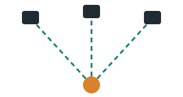{fig-alt="GPS receiver on the ground linked to three satellites" width="80%"}

**GPS** finds a receiver's position from satellite signals: three satellites for latitude and longitude, four to add altitude.

[Health use: geocoding every homestead]{.muted .small}
:::
::: {.column width="2%"}
:::
::: {.column width="32%"}
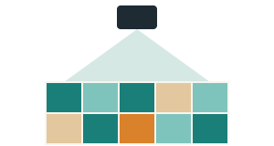{fig-alt="Satellite above a grid of land cover cells" width="80%"}

**Remote sensing** captures images from satellites or aircraft, classified into land cover, crops and water.

[Health use: mapping mosquito habitat]{.muted .small}
:::
::: {.column width="2%"}
:::
::: {.column width="32%"}
{fig-alt="Three stacked map layers" width="80%"}

**GIS** creates, stores and analyses geographic data by combining maps with spreadsheets.

[Health use: overlaying cases, clinics and roads]{.muted .small}
:::
::::

::: {.notes}
The chapter introduces three geospatial technologies. GPS works out where a receiver is from radio signals sent by satellites: three satellites give a two-dimensional position, latitude and longitude, and four add altitude. GPS is also a data collection tool. Fieldworkers can record points, lines and areas, and as we will see, the ACDIS site mapped every homestead this way. Remote sensing is imagery taken from satellites or aircraft. Beyond basemaps, it can be classified into land use and land cover, and the chapter notes its public health use for finding areas of mosquito infestation. GIS is the software that brings it all together: it stores where things are alongside what they are, and lets us analyse them.
:::

## Layers join where something is to what it is

:::: {.columns}
::: {.column width="40%"}
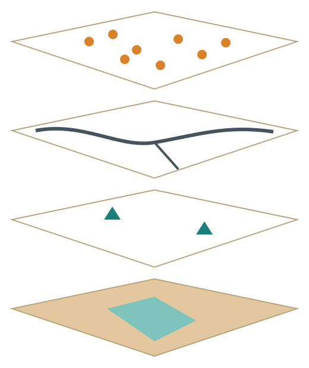{fig-alt="Four stacked map layers: from top, homesteads as points, roads as lines, clinics as points, and land cover as areas" height="620"}
:::
::: {.column width="60%"}
Top to bottom: **homesteads** (points), **roads** (lines), **clinics** (points), **land cover** (areas).

Each feature has a location plus a row in an **attribute table**.

| homestead_id | members | piped_water | mins_to_clinic |
|---|---|---|---|
| H-00412 | 8 | Yes | 45 |
| H-00413 | 5 | No | 95 |
| H-00414 | 11 | Yes | 70 |

[Illustrative values, not real ACDIS records]{.muted .small}
:::
::::

::: {.notes}
The chapter describes GIS as bringing the power of maps and spreadsheets together. Spatial data records the location of things; attribute data records their characteristics. GIS stores data as layers, each with a single theme. Picture a health study area: one layer of homesteads, one of roads, one of clinics, one of land cover. Every feature in a layer is linked to a row in an attribute table, like the one on the right. Because location and attributes stay linked, you can map any column: colour homesteads by whether they have piped water, or by how long it takes to reach a clinic. The values in this table are made up for illustration.
:::

## Vector stores objects. Raster stores a grid.

[Beyond the textbook · data models]{.eyebrow}

:::: {.columns}
::: {.column width="48%"}
::: {.card}
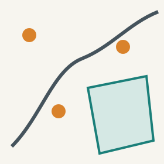{fig-alt="Vector data: points, a line and a polygon" width="35%" fig-align="left"}

**Vector:** points, lines and polygons with exact edges. Clinics, roads, districts.

[In ArcGIS Online: feature layers]{.muted .small}
:::
:::
::: {.column width="4%"}
:::
::: {.column width="48%"}
::: {.card}
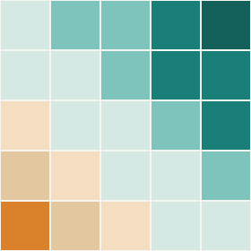{fig-alt="Raster data: a grid of cells shaded by value" width="35%" fig-align="left"}

**Raster:** a grid of equal cells, one value each. Imagery, elevation, rainfall.

[In ArcGIS Online: imagery and tile layers]{.muted .small}
:::
:::
::::

**Rule of thumb:** discrete things with boundaries → vector. Values that change continuously → raster.

::: {.notes}
This slide goes beyond the textbook, which does not cover data models. Every GIS layer is stored in one of two ways. Vector data represents discrete objects as points, lines and polygons with exact boundaries, and each object has its own row of attributes. A clinic is a point, a road is a line, a health district is a polygon. Raster data divides space into a grid of equal cells, and each cell holds a single value, such as elevation, rainfall or the brightness recorded by a satellite. The size of the cells is the resolution: smaller cells mean more detail and bigger files. In ArcGIS Online, vector data appears as feature layers, and raster data appears as imagery or tile layers. The rule of thumb: if it is a thing with a boundary, use vector; if it is a value that varies continuously across the landscape, use raster.
:::

## Five questions to ask before you trust a dataset

| Dimension | Ask | Health example |
|---|---|---|
| **Spatial accuracy** | Right place? How precise? | A clinic geocoded to the wrong town |
| **Temporal accuracy** | When made? Still current? | An old clinic list used to plan today |
| **Attribute accuracy** | Values right? Error margins? | Prevalence from a tiny sample |
| **Completeness** | Are any features missing? | A blank that means no data, not no cases |
| **Data source** | Who made it? Reliable? | A census bureau versus an unknown blog |

The answers live in the dataset's **metadata**, its data about the data.

::: {.notes}
The chapter warns that interesting data is not the same as good data. It lists five common quality issues. Spatial accuracy: is a feature in the correct location, and to what precision? A hospital placed at the right street address in the wrong city is a spatial error. Temporal accuracy: when was the data created, and is it still current? Attribute accuracy: are the values correct, and how big are the margins of error? Completeness: are all the features there? In public health this one is dangerous, because a blank on a map can be read as no cases when it really means no data. And data source: a national statistics agency is held to higher standards than an anonymous website. Most of these answers should be in the metadata, which we look at next.
:::

## A surveillance system built on quality spatial data {background-color="#1E2B33" .dark}

[Public health case · ACDIS]{.eyebrow}

About 85,000 people in 11,000 households across 438 km² near Mtubatuba, uMkhanyakude district, KwaZulu-Natal.

:::: {.columns}
::: {.column width="25%"}
[\<2 m]{.bignum}

Differential GPS accuracy for every homestead

[Spatial accuracy]{.small}
:::
::: {.column width="25%"}
[6 mo]{.bignum}

Household visits; new homesteads added as built

[Temporal accuracy]{.small}
:::
::: {.column width="25%"}
[\>99%]{.bignum}

Household participation

[Completeness]{.small}
:::
::: {.column width="25%"}
[60→40%]{.bignum}

Consent to HIV testing fell, 2003 to 2006

[Completeness risk]{.small}
:::
::::

[Source: Tanser F, et al. Int J Epidemiol. 2008;37(5):956-962. [doi:10.1093/ije/dym211](https://doi.org/10.1093/ije/dym211)]{.small}

::: {.notes}
This is this week’s assigned paper, the cohort profile of the Africa Centre Demographic Information System, or ACDIS. ACDIS is a health and demographic surveillance system that began in 2000 in rural KwaZulu-Natal, South Africa, in an area facing a severe HIV epidemic. Read it with the five quality questions in mind. Spatial accuracy: fieldworkers mapped every homestead and facility with differential GPS to an accuracy of under two metres. Temporal accuracy: households are visited every six months and the homestead database is updated as new homesteads are built. Completeness: household participation is over ninety-nine percent. But the HIV survey shows the other side. Consent to HIV testing fell from about sixty percent to about forty percent, which the authors flag as a risk of selection bias, and they describe methods to adjust for it. A map of HIV prevalence built only from people who agreed to test could be misleading. That is exactly the completeness problem from the previous slide.
:::

## Read the item page before you add a layer

:::: {.columns}
::: {.column width="45%"}
::: {.card}
**ArcGIS Online item page**

- **Description**: what it is, how made
- **Credits (Attribution)**: who made it
- **Details**: created and updated
- **Terms of Use**: limits on use
- **Data tab**: attribute fields
:::
:::
::: {.column width="5%"}
:::
::: {.column width="50%"}
Metadata is information about a dataset: who made it, when, how it was collected, its coordinate system and its quality.

[If a layer has no description, no source and no date, treat it as untrustworthy until you can verify it.]{.muted}

You will practise this in **Exercise 1.1**.
:::
::::

::: {.notes}
The chapter defines metadata as information about a dataset: its quality, collection methods, who produced it, its projection and coordinate system, and more. In ArcGIS Online, the metadata lives on each layer’s item page. Before you add a layer to a map, open its item page. Read the summary and description to learn what it is and how it was made. Check the credits to see who produced it. Look at the created and updated dates. Read the terms of use. And open the data tab to see which fields are in the attribute table. A layer with no description, no source and no date should be treated with suspicion. You will practise finding and judging layers in Exercise 1.1.
:::

## Reference maps orient. Thematic maps argue one topic.

:::: {.columns}
::: {.column width="48%"}
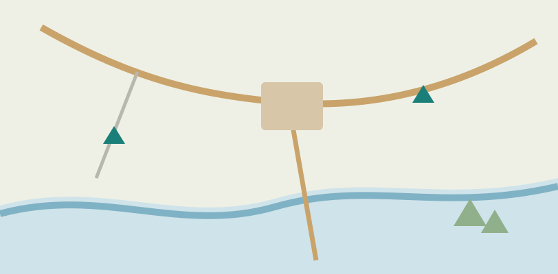{fig-alt="Reference map with a river, roads, a town and clinics"}

**Reference:** many general features. The ArcGIS Online **basemap** is a reference map.
:::
::: {.column width="4%"}
:::
::: {.column width="48%"}
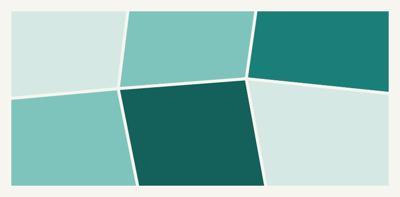{fig-alt="Thematic choropleth map of districts shaded by a single variable"}

**Thematic:** one topic, such as HIV prevalence by district. Living Atlas layers are thematic.
:::
::::

::: {.notes}
The chapter sorts maps into two broad categories. Reference maps carry a wide range of general information: roads, rivers, towns, public buildings, elevation. When you create a new map in ArcGIS Online, the basemap is a reference map. Thematic maps focus on a single topic, such as population density, income, or in our field, HIV prevalence by district. When you add a layer from ArcGIS Living Atlas to your map, you are adding a thematic map on top of the reference basemap. Most public health maps are thematic maps sitting on a reference basemap.
:::

## Six ways to show one theme

:::: {.columns}
::: {.column width="33%"}
{fig-alt="Choropleth: areas shaded by value" width="45%"}
**Choropleth**: shaded areas. HIV prevalence by district.

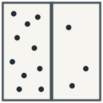{fig-alt="Dot density: dots placed within areas" width="45%"}
**Dot density**: 1 dot = N units. Households per ward.
:::
::: {.column width="33%"}
{fig-alt="Graduated circles: circle size shows amount" width="45%"}
**Graduated circle**: circle size. Patients per clinic.

{fig-alt="Flowlines: line thickness shows amount moving between places" width="45%"}
**Flowline**: line width. Migration to cities.
:::
::: {.column width="33%"}
{fig-alt="Isolines: lines joining equal values" width="45%"}
**Isoline**: lines of equal value. Rainfall, elevation.

{fig-alt="Cartogram: area resized by value" width="45%"}
**Cartogram**: area resized. Countries by deaths.
:::
::::

::: {.notes}
The chapter describes six kinds of thematic map. Choropleth maps shade areas such as districts by a value, and they are the workhorse of public health mapping. Graduated circle maps use circle size instead of colour, which works well for amounts at a place, like patients seen at each clinic. Isoline maps join points of equal value and suit continuous surfaces like temperature, rainfall or elevation. Dot density maps scatter dots inside each area, where one dot stands for a fixed number of people or households. Flowline maps use line thickness to show how much moves between places, such as migration. Cartograms resize areas by a value, so a country with more deaths appears bigger. Choosing the right type is the first design decision for any map you make.
:::

## Large scale means zoomed in

:::: {.columns}
::: {.column width="34%"}
Scale is map distance relative to real-world distance.

::: {.card}
**Verbal**: 1 inch equals 1 mile

**Ratio**: 1:24,000

**Graphic**: a scale bar
:::

[1:24,000 is a bigger fraction than 1:100,000, so it is the **larger** scale.]{.muted}
:::
::: {.column width="33%"}
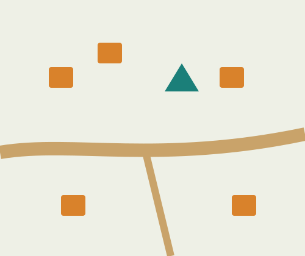{fig-alt="Large-scale map: a few homesteads, a clinic and a road in detail"}

**Large scale · 1:5,000**: small area, much detail.
:::
::: {.column width="33%"}
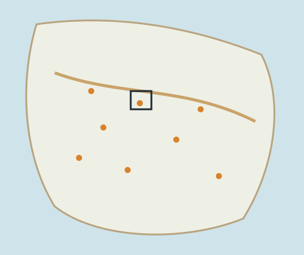{fig-alt="Small-scale map: a whole region with many points and less detail"}

**Small scale · 1:1,000,000**: large area, little detail.
:::
::::

::: {.notes}
Scale tells you how map distance relates to real distance. It can be written in words, like one inch equals one mile; as a ratio, like one to twenty-four thousand, where one unit on the map is twenty-four thousand of the same unit on the ground; or drawn as a scale bar. Students often find large and small scale backwards, so think of the fraction. One over five thousand is a bigger fraction than one over a million, so it is the larger scale. Large-scale maps are zoomed in: a small area shown in great detail, like a single village where you can see each homestead and the clinic. Small-scale maps are zoomed out: a large area with less detail, like a whole province. The textbook’s trick: your neighbourhood looks large on a large-scale map. The small box on the right map shows roughly where the left map would sit.
:::

## Same cases, different units, different story

:::: {.columns}
::: {.column width="30%"}
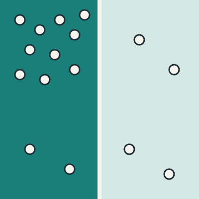{fig-alt="Two large zones: the whole western zone appears high"}

**2 large zones**: the whole west looks high
:::
::: {.column width="30%"}
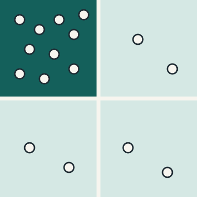{fig-alt="Four smaller zones: only the north-west zone is high"}

**4 smaller zones**: only the north-west is high
:::
::: {.column width="40%"}
The **modifiable areal unit problem (MAUP)**: the units you aggregate to change the pattern you see.

[There is no single right scale. Match the unit to the decision: provinces for national funding, wards for outreach.]{.muted}

The 16 dots are identical in both maps.
:::
::::

::: {.notes}
Scale also matters for analysis, not just for drawing. The textbook calls this the modifiable areal unit problem, or MAUP: the units you aggregate data to, whether provinces, districts or wards, can strongly change the patterns you see. Look at the two maps. The sixteen case locations are exactly the same. On the left, with two large zones, the entire western half looks like a high-burden area, and you might send resources across the whole west. On the right, with four smaller zones, it is clear that the burden is concentrated in the north-west only. The textbook uses the example of US election results by state versus by county. The lesson is the same: there is no single proper scale. Choose the unit that matches the question and the decision you need to make.
:::

## Flattening a globe always distorts something

:::: {.columns}
::: {.column width="36%"}
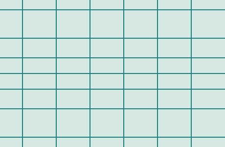{fig-alt="Mercator grid: parallels spread farther apart toward the poles"}

**Conformal · Mercator**: keeps shape, inflates area toward the poles. ArcGIS Online uses **Web Mercator**.
:::
::: {.column width="36%"}
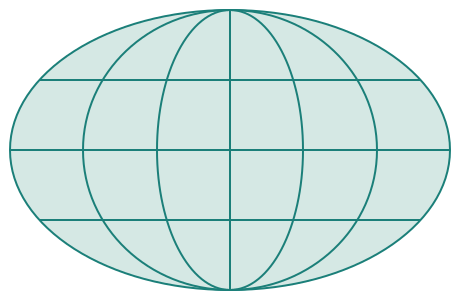{fig-alt="Mollweide grid: an ellipse with curved meridians"}

**Equal-area · Mollweide**: keeps area, distorts shape. Better for comparing rates across countries.
:::
::: {.column width="28%"}
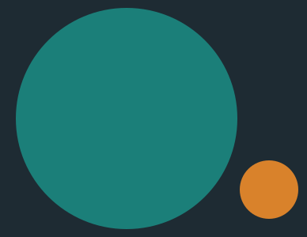{fig-alt="Circles comparing true areas: Africa is about fourteen times larger than Greenland"}

**True size**: Africa (teal) is about 14 times larger than Greenland (orange).
:::
::::

::: {.notes}
A projection turns the round Earth into a flat map. The chapter compares it to flattening an orange peel: you cannot do it without tearing or stretching. A projection cannot preserve area, shape, distance and direction all at once. Conformal projections, like Mercator, keep shapes correct but distort area, which grows dramatically toward the poles. ArcGIS Online uses Web Mercator, a slightly modified version, which is why high-latitude countries look huge on its basemaps. Equal-area projections, like Mollweide, keep area correct but bend shapes. The famous example: on Mercator, Greenland looks about the same size as Africa, but Africa is about fourteen times larger, as the circles on the right show. For public health, this matters when you map rates across countries. Big, distorted areas draw the eye, so a global comparison is fairer on an equal-area projection.
:::

## A coordinate only means something with its datum

[Coordinates and datums · partly beyond the textbook]{.eyebrow}

:::: {.columns}
::: {.column width="33%"}
::: {.card}
**Latitude and longitude**

Angles from the equator (0° to 90°) and the prime meridian (0° to 180°).

South and west are **negative** in decimal degrees.

ACDIS area: about 28.4° S, 32.2° E = **−28.4, 32.2**
:::
:::
::: {.column width="33%"}
::: {.card}
**Datum**

A model of the Earth's shape that coordinates are measured against.

**WGS 84** is the GPS datum and the web map default.

Another datum can shift a point tens to hundreds of metres.
:::
:::
::: {.column width="33%"}
::: {.card}
**Projected (UTM)**

Flat x and y in metres, for easy distance and area.

60 zones, each 6° wide.

The ACDIS area is in **UTM zone 36S**.
:::
:::
::::

::: {.notes}
The textbook introduces latitude and longitude. Latitude runs from zero at the equator to ninety degrees at each pole, and longitude from zero at the Greenwich prime meridian to one hundred eighty degrees east or west. Coordinates can be written as degrees, minutes and seconds, or as decimal degrees. One thing the book’s US examples hide: in decimal degrees, south and west are negative. Our study area in KwaZulu-Natal is in the southern and eastern hemispheres, so a location near Mtubatuba is about minus twenty-eight point four, thirty-two point two. Get the sign wrong and your points land in the ocean or another continent. Two ideas go beyond the textbook. First, a datum is the model of the Earth’s shape that coordinates are measured against. GPS uses WGS 84, and so do most web maps. The same numbers interpreted on a different datum can be off by tens to hundreds of metres. Second, projected coordinate systems like UTM give flat x and y coordinates in metres, which makes measuring distance and area simple. The world is divided into sixty UTM zones, and the ACDIS area falls in zone 36 South.
:::

## Counts show where people are. Rates show risk.

:::: {.columns}
::: {.column width="28%"}
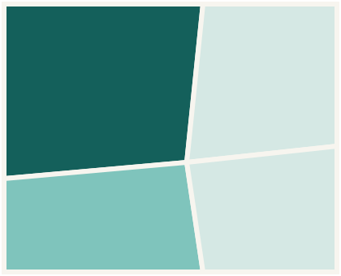{fig-alt="Count map: the large town district is darkest"}

**Cases (count)**: town district, 2,000 cases
:::
::: {.column width="28%"}
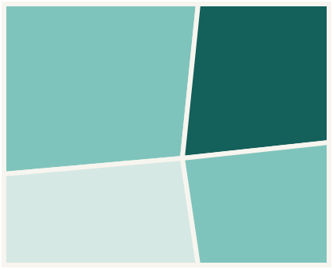{fig-alt="Rate map: a small rural district is darkest"}

**Rate per 100,000**: rural district, 3,000
:::
::: {.column width="44%"}
::: {.card}
**Rate** = cases ÷ population × 100,000
:::

| District | Cases | Pop. | Rate |
|---|---|---|---|
| Town | 2,000 | 200,000 | 1,000 |
| Rural | 600 | 20,000 | 3,000 |

[Illustrative values]{.muted .small}

**Shade areas by rates. Show counts with circles or dots.**
:::
::::

::: {.notes}
The chapter says novice map users often confuse counts and rates, and in public health this is one of the most important distinctions you will make. A count is simply the number of cases in an area. A rate divides that count by the population, or sometimes by area, so places of different sizes can be compared. In this made-up example, the town district has two thousand cases, the most of any district, so it is darkest on the count map. But it also has two hundred thousand people, giving a rate of one thousand per hundred thousand. The small rural district has only six hundred cases, but among just twenty thousand people that is three thousand per hundred thousand, three times the town’s risk. The count map tells you where the most cases are, which matters for planning services. The rate map tells you where risk is highest. A good rule: when you shade areas on a choropleth, use rates; to show counts, use graduated circles or dots.
:::

## Same data, new class breaks, a different map

:::: {.columns}
::: {.column width="48%"}
::: {.card}
{fig-alt="Equal interval: seven of nine districts in the lightest class" width="40%" fig-align="left"}

**Equal interval**: equal-width ranges. Skewed data piles into one class.

{fig-alt="Number line of the nine values with equal interval breaks at about 15 and 27"}
:::
:::
::: {.column width="4%"}
:::
::: {.column width="48%"}
::: {.card}
{fig-alt="Quantile: three districts in each class" width="40%" fig-align="left"}

**Quantile**: same number of areas per class. A third always looks "high".

{fig-alt="Number line of the nine values with quantile breaks at about 4.5 and 10"}
:::
:::
::::

The data never changed, only the cut points (orange lines). **Always check the legend's breaks.**

::: {.notes}
A choropleth map sorts values into classes and gives each class a colour. The chapter shows that the classification scheme can change the impression a map gives without changing the data at all. Here are the same nine district values, skewed like most health data: most are low and one is very high. Equal interval splits the range into equal-width bins. Because one district is extreme, seven of nine fall into the lightest class and the map looks reassuring. Quantile puts the same number of districts in each class, so a third of the map always appears high, even when the differences are small. The dots on each number line are the nine values, and the orange lines are the class breaks. ArcGIS Online also offers natural breaks, which groups similar values, and standard deviation, which shows distance from the mean. None is always right. The habit to build is to always read the legend’s breaks before you believe a map’s message. You will try this yourself in Exercise 1.2.
:::

## Distance to care is rarely a straight line

:::: {.columns}
::: {.column width="45%"}
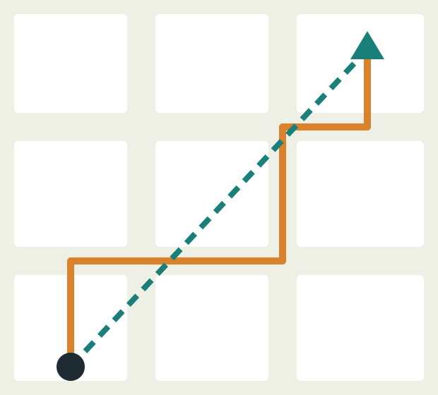{fig-alt="Home and clinic on a street grid: a straight green line and a longer orange route along the streets"}
:::
::: {.column width="55%"}
**Euclidean** (green): straight line, "as the crow flies"

**Manhattan or network** (orange): along the roads people use

**Cost distance**: weighted by time, terrain or money

::: {.card .tint}
In the ACDIS area, the median travel time to the nearest clinic was **81 minutes**, estimated with a GIS cost model.
:::

[Source: Tanser F, Gijsbertsen B, Herbst K. Soc Sci Med. 2006;63(3):691-705]{.small .muted}
:::
::::

::: {.notes}
Geographers describe location in absolute terms, like coordinates or a street address, and in relative terms, like close to a road or far from a clinic. Relative location usually explains more. Distance works the same way. Euclidean distance is the straight line between two points, as the crow flies, shown in green. Manhattan or network distance follows the street grid, shown in orange, and is always longer. Cost distance weights distance by how hard it is to travel, whether in time, terrain or money: a short route over a steep hill may cost more than a longer flat one. For health access, cost distance is usually what matters. In a study we will read in Week 6, researchers in the ACDIS area interviewed and mapped about twenty-three thousand homesteads and built a GIS travel-time model. The median travel time to the nearest clinic was eighty-one minutes, and clinic use fell steeply as travel time rose. Exercise 1.3 in the textbook practises these distance measures if you want extra practice.
:::

## Clustered, random or dispersed?

:::: {.columns}
::: {.column width="20%"}
{fig-alt="Clustered points grouped together"}

**Clustered**: look for a shared cause
:::
::: {.column width="20%"}
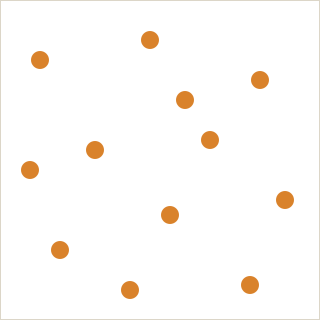{fig-alt="Random points with no pattern"}

**Random**: no spatial process evident
:::
::: {.column width="20%"}
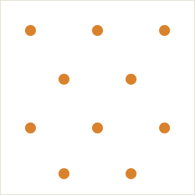{fig-alt="Dispersed points evenly spaced"}

**Dispersed**: features repel, like clinics
:::
::: {.column width="40%"}
::: {.card .tint}
**ACDIS HIV survey:** prevalence was over **35%** in informal settlements near the national road, and under **10%** in remote rural areas.
:::

Hot spot analysis tests whether a cluster is more than chance. **Density** = features per unit area. Practise both in **Exercise 1.4**.

[Source: Tanser F, et al. Int J Epidemiol. 2008;37(5):956-962]{.small .muted}
:::
::::

::: {.notes}
Features on the Earth’s surface form spatial patterns, and the pattern hints at the process behind it. Density is the number of features per unit area, and it reveals patterns that raw numbers hide. Beyond density, patterns can be clustered, random or dispersed. Clustered features are grouped together, which suggests a shared cause: the chapter’s example is a cancer cluster that leads researchers to look for an environmental source. Random features show no particular pattern. Dispersed features repel each other, as when clinics or shops are spaced out to serve different areas. Hot spot analysis tests whether a cluster is statistically significant rather than chance. In our assigned paper, HIV was far from uniform: prevalence was over thirty-five percent in informal settlements near the national road and under ten percent in the more inaccessible rural areas. Exercise 1.4 has you analyse clustering in homicide data in Chicago, using the same tools you could apply to disease.
:::

## Things that overlap are not always cause and effect

:::: {.columns}
::: {.column width="18%"}
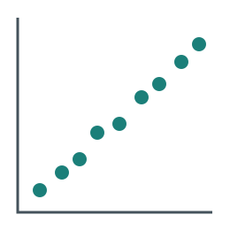{fig-alt="Positive correlation scatterplot"}

**Positive**
:::
::: {.column width="18%"}
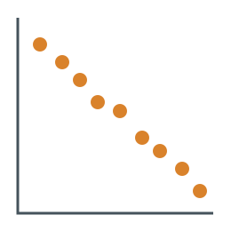{fig-alt="Negative correlation scatterplot"}

**Negative**
:::
::: {.column width="18%"}
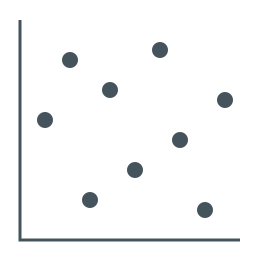{fig-alt="No correlation scatterplot"}

**None**
:::
::: {.column width="46%"}
Relationships compare **two or more features**: how far apart they are, and whether they overlap.

::: {.card}
**The chapter's warning:** a cancer cluster sits near a factory, but the real cause is a mine where many residents work.
:::

Use theory and past research to choose what you map.
:::
::::

::: {.notes}
Spatial distributions describe how one kind of feature is arranged. Spatial relationships compare two or more kinds: how far apart they are and whether they overlap. Spatial correlation measures the strength and direction of a relationship. Positive means both variables rise together, negative means one rises as the other falls, and none means no pattern. The chapter repeats a warning you know from epidemiology: correlation does not imply causation. Its example is a cancer cluster near a site that releases toxic effluent. People infer the site causes the cancer, but the real cause turns out to be a third variable: many residents of the cluster work in a mine that uses toxic chemicals. The lesson for GIS work is to choose the layers you analyse using theory and earlier research, and to consider other explanations before concluding that overlap means cause.
:::

## Three ways to draw a region

:::: {.columns}
::: {.column width="33%"}
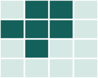{fig-alt="Formal region: an area of cells sharing the same value" width="60%"}

**Formal**: shares a measurable trait. *A malaria-endemic zone.*
:::
::: {.column width="33%"}
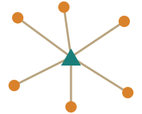{fig-alt="Functional region: homesteads linked to one central clinic" width="60%"}

**Functional**: a node and the area that interacts with it. *A clinic's catchment area.*
:::
::: {.column width="33%"}
{fig-alt="Perceptual region: several hand-drawn overlapping boundaries" width="60%"}

**Perceptual**: drawn from how people see it; fuzzy edges. *"The township" as residents describe it.*
:::
::::

**Places** are unique locations with a **sense of place**. **Regions** group locations by shared traits.

::: {.notes}
The chapter distinguishes places from regions. Places are locations with a unique mix of human and physical features, and people form a sense of place, an emotional reaction, as they experience them. People navigate using mental maps, which are more detailed where they travel often. Regions group locations by a limited set of shared characteristics, and there are three types. Formal regions are defined by mapping one or more measurable traits, such as the textbook’s Corn Belt or Tornado Alley; in health, a malaria-endemic zone. Functional regions are defined by a central node and the surrounding area that interacts with it: a clinic and its catchment area is a functional region, and so is a commuter zone around a city. Perceptual, or vernacular, regions come from how people perceive an area, so their edges are fuzzy. One way to find them is to ask many people to draw the boundary and look for the consensus. Exercise 1.5 explores these ideas if you want more practice.
:::

## Near things are more related than distant things

:::: {.columns}
::: {.column width="35%"}
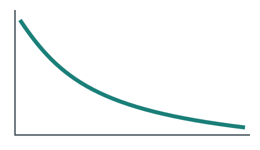{fig-alt="Distance decay curve: interaction falls as distance increases"}

**Distance decay** (Tobler's first law): interaction falls as distance grows.

**Barriers** slow diffusion: rivers and mountains, or language and stigma.
:::
::: {.column width="65%"}
| Diffusion | How it spreads | Health example |
|---|---|---|
| **Relocation** | People carry it as they move | An infection brought home by a returning migrant |
| **Contagious** | Person to person, by nearness | A measles outbreak rippling outward |
| **Hierarchical** | From big or powerful places down | New drugs reach city hospitals before rural clinics |
| **Stimulus** | The idea spreads and changes | Clinic HIV testing adapted to home-based testing |
:::
::::

[Textbook note: the flu pandemic in this section is the 1918 pandemic, not 1891 as printed.]{.small .muted}

::: {.notes}
Patterns form through movement and interaction. Something starts at an origin, sometimes called a hearth, and spreads. Spatial interaction depends on connectivity and accessibility, and it is shaped by distance, as described by Tobler’s first law of geography: everything is related to everything else, but near things are more related than distant things. That gives us distance decay, where interaction falls as distance grows. The chapter names several kinds of diffusion. Relocation diffusion happens when people move and take something with them, which is how migration can carry infections between cities and rural homes; we return to this in Week 3. Expansion diffusion increases the number of people with something, and comes in two forms: contagious, spreading by proximity like ripples in a pond, and hierarchical, spreading from large or powerful places down to smaller ones. Stimulus diffusion is when an idea spreads but changes as it is adapted locally. Diffusion also meets barriers, both physical, like rivers and mountains, and cultural, like language or, in health, stigma. One correction: the textbook refers to the deadly flu pandemic of 1891 in this section. It means the 1918 pandemic, as its own reference list shows. Exercise 1.6 practises these ideas.
:::

## The environment sets limits. People reshape them.

:::: {.columns}
::: {.column width="33%"}
::: {.card}
**Environmental determinism**

The old idea that environment decides how people live and develop. Largely rejected.
:::
:::
::: {.column width="33%"}
::: {.card}
**Possibilism**

Environment offers options and constraints. Technology and choices overcome many of them.
:::
:::
::: {.column width="33%"}
::: {.card}
**Hazard perception**

How people view risk shapes where they build and live, such as on flood plains.
:::
:::
::::

::: {.card .tint}
[43% → 78%]{.bignum} ACDIS households with piped water, 2001 to 2006. Changing the environment changes exposure. We map this in Week 7.
:::

[Source: Tanser F, et al. Int J Epidemiol. 2008;37(5):956-962]{.small .muted}

::: {.notes}
The last part of the chapter is the ecological perspective, also called cultural ecology: how humans and their environment shape each other. Environmental determinism was the old idea that climate and landscape decide how people live and even how societies develop. It fell out of favour, partly because successful societies have grown in environments once thought too harsh. Possibilism is the more accepted view: the environment creates possibilities and constraints, but human ingenuity overcomes many of them. The chapter also discusses environmental perception, meaning how people view risk. Many people perceive natural hazards as controllable and build on flood plains or fire-prone hillsides. For public health, the key point is that people change their environment, and that changes their exposure. In the ACDIS area, households reporting piped water almost doubled, from forty-three to seventy-eight percent, between 2001 and 2006. In Week 7 we will read a study that used ACDIS data to measure what that change meant for a waterborne disease.
:::

## Critical lens: geography grew up with empire

:::: {.columns}
::: {.column width="50%"}
::: {.card}
**Maps served conquest.** European exploration and colonial surveys mapped land to claim it. At the 1884–85 Berlin Conference, European powers set rules for dividing Africa, and many borders were drawn with little regard for the people living there.
:::

::: {.card}
**Europe at the centre.** Mercator puts Europe near the middle and enlarges the high latitudes. Names like "Middle East" and "Far East" describe places by their distance from Europe.
:::
:::
::: {.column width="50%"}
::: {.card}
**Ranking peoples.** Environmental determinism was used to claim that temperate, European societies were naturally superior, a justification for colonial rule.
:::

::: {.card}
**Counting by race.** The first US censuses counted people as free or enslaved. Apartheid South Africa classified every person by race and used maps to separate them.
:::
:::
::::

::: {.notes}
Before we finish, a critical lens on the discipline itself. Geography and mapmaking grew up alongside European empire. Explorers and colonial surveyors mapped land in order to claim, tax and govern it. At the Berlin Conference of 1884 and 1885, European powers agreed rules for dividing Africa among themselves, and many of the resulting borders paid little attention to the people who lived there. Our everyday maps carry that history: the Mercator projection puts Europe near the centre and inflates the high latitudes, and as the chapter points out, names such as the Near, Middle and Far East describe places by their distance from Europe. Ideas could be harmful too. The chapter describes environmental determinism, the belief that temperate climates made European societies vigorous and productive while tropical climates held others back. That idea was used to justify colonial rule. And counting people has never been neutral. As we will see in Week 4, the first US censuses classified people as free or enslaved, and apartheid South Africa classified every person by race and then used maps and laws to separate them. None of this means maps are bad. It means every map reflects choices about who is counted, how and why.
:::

## How the field is responding

:::: {.columns}
::: {.column width="33%"}
::: {.card}
**Counter-mapping**

Communities make their own maps, to document land claims, hazards or services that official maps leave out.
:::
:::
::: {.column width="33%"}
::: {.card}
**Community oversight**

ACDIS discusses every research initiative with a Community Advisory Board of about 25 members chosen by the community.
:::
:::
::: {.column width="33%"}
::: {.card .tint}
**Data governance**

The CARE Principles for Indigenous Data Governance: **C**ollective benefit, **A**uthority to control, **R**esponsibility, **E**thics.
:::
:::
::::

Throughout this course, a **Critical lens** slide each week asks how power, colonialism and racism shaped that week's topic.

[ACDIS: Tanser F, et al. Int J Epidemiol. 2008;37(5):956-962]{.small .muted}

::: {.notes}
The field is responding in several ways. Counter-mapping, sometimes called participatory mapping, puts mapping in the hands of communities, who use it to document land claims, environmental hazards or services that official maps leave out. Public health research has developed community oversight. The ACDIS cohort profile you read this week explains that every research initiative is first discussed with a Community Advisory Board of about twenty-five members chosen by the community, who also help decide how results are shared. And researchers are adopting principles for data governance. The CARE principles for Indigenous data governance ask that data bring collective benefit, that communities have authority to control data about them, and that researchers act with responsibility and ethics. Each week from now on, a critical lens slide asks how power, colonialism, racism and other forms of discrimination shaped that week’s topic and the data we use to study it.
:::

## Every map is an argument. Question it. {background-color="#1B7F79" .dark}

:::: {.columns}
::: {.column width="50%"}
1. Who made the data, and when?
2. What is missing?
3. Counts or rates?
:::
::: {.column width="50%"}
4. Which class breaks?
5. Which projection?
6. Which areal units?
:::
::::

::: {.notes}
To pull the week together: every map is an argument, made through dozens of choices, and a good public health analyst questions those choices before acting on the map. Here are six questions to ask of any health map, whether you made it or someone else did. Who made the data, and when? What is missing, and could a blank mean no data rather than no cases? Is it showing counts or rates? What class breaks were used? What projection, and is it distorting area? And what areal units were used, and would a different unit tell a different story? These six questions are on your Week 1 handout, which you can keep as a reference for the rest of the course.
:::

## Your Week 1 tasks

| Task | Where |
|---|---|
| Read Chapter 1 | Textbook |
| Read Tanser et al. (2008) | [Readings page](../../readings.qmd) |
| Exercises 1.1, 1.2 and 1.4 | ArcGIS Online |
| Reading check | Canvas |

**Optional practice:** Exercises 1.3, 1.5, 1.6 and 1.7. **Exercise links:** [esri.com/Human-Geography](https://www.esri.com/Human-Geography). Due dates are in Canvas.

::: {.notes}
Here is what to finish before Week 2. Read Chapter 1 and the Tanser and colleagues cohort profile, which is linked on the course site's Readings page. Complete ArcGIS Online exercises 1.1, 1.2 and 1.4 from the textbook. You will find the links on the book’s resource page at esri.com slash Human-Geography. Then complete this week’s reading check in Canvas. If you want more practice, exercises 1.3, 1.5, 1.6 and 1.7 follow the rest of the chapter. Keep your Week 1 handout nearby: it summarises every concept from today and works as a cheat sheet for the labs.
:::
