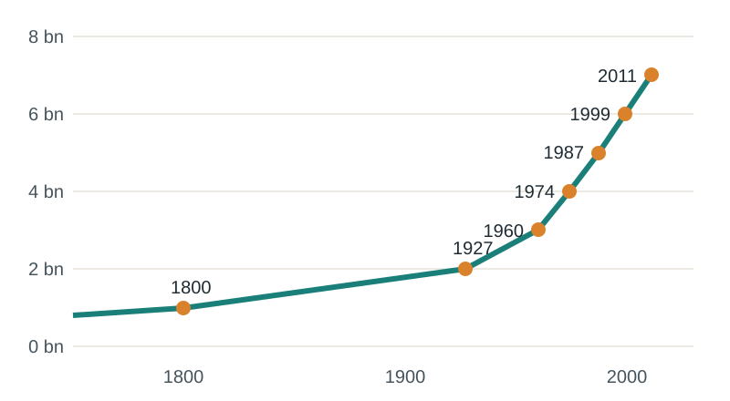
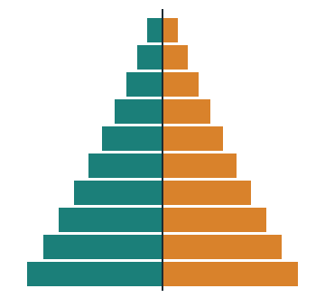
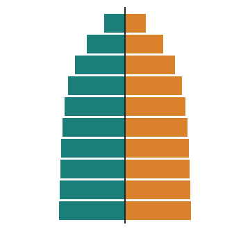
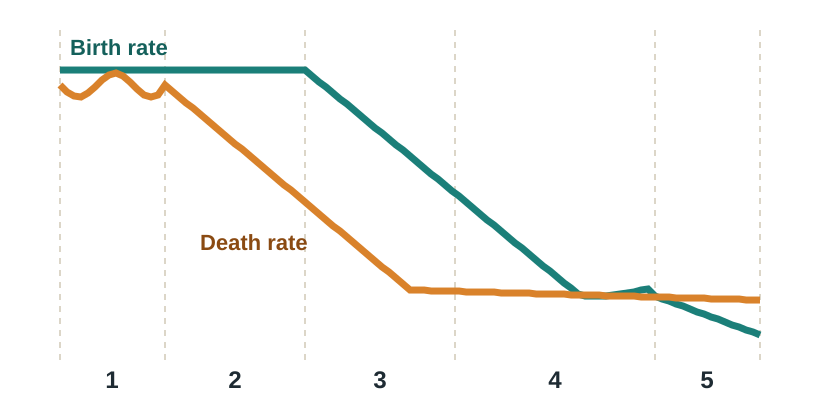

## This week

:::: {.columns}
::: {.column width="32%"}
::: {.card}
**Read**

Chapter 2, Population

Bor et al. (2013). Increases in adult life expectancy in rural South Africa
:::
:::
::: {.column width="2%"}
:::
::: {.column width="32%"}
::: {.card}
**Map**

Exercise 2.1 Spatial distribution of population

Exercise 2.2 Fertility rates

Exercise 2.3 Death rates and natural increase

Exercise 2.4 Population structure
:::
:::
::: {.column width="2%"}
:::
::: {.column width="32%"}
::: {.card .tint}
**Be able to**

Calculate and map demographic rates

Read a population pyramid

Explain why crude rates can mislead
:::
:::
::::

::: {.notes}
Welcome to Week 2. Last week we learned how to judge a map. This week we look at the data behind almost every public health map: population. Read Chapter 2 and the paper by Bor and colleagues, which uses ACDIS data to measure how much adult life expectancy rose after HIV treatment arrived. Then work through ArcGIS Online exercises 2.1 to 2.4. By the end of the week you should be able to calculate and map demographic rates, read a population pyramid, and explain why crude rates can mislead when you compare places.
:::

## Population is the denominator of public health {background-color="#1B7F79" .dark}

Every rate you map divides by people. Know where they are, how old they are, and how fast they are changing.

::: {.notes}
Here is the big idea of the week. Nearly every measure in public health, whether incidence, prevalence, mortality or coverage, is a count divided by a population. If the population is wrong, the rate is wrong. And because births, deaths and migration change populations over time, the denominator is always moving. Demography gives us the tools to measure that, and GIS lets us see how it varies from place to place.
:::

## Each added billion arrived faster

:::: {.columns}
::: {.column width="58%"}
{fig-alt="World population reached 1 billion around 1800, then 7 billion by 2011, each additional billion arriving faster"}
:::
::: {.column width="42%"}
1 billion around **1800**. 2 billion by **1927**. 7 billion by **2011**.

[Growth peaked in the late 1960s and has slowed since. The UN projected about 11.2 billion by 2100.]{.muted}

People are **clustered**: East Asia, South Asia and Europe hold the largest concentrations.
:::
::::

::: {.notes}
The chapter starts with the big picture. The world did not reach one billion people until around 1800. After that, each additional billion came faster: two billion by 1927, three by 1960, and seven by 2011. One small correction: a figure caption in the book says population stayed flat until 2015; it means until about 1800, as the text and the chart make clear. The growth rate itself peaked between 1965 and 1970 and has fallen since, so the population is still growing but more slowly. The projection quoted in the book was about 11.2 billion by 2100. The other key point is that people are not spread evenly. They cluster, with the largest clusters in East Asia, South Asia and Europe, and many smaller clusters in large urban areas.
:::

## Three ways to measure density

| Measure | Formula | Tells you |
|---|---|---|
| **Arithmetic density** | people ÷ total land area | How crowded a place is |
| **Physiological density** | people ÷ arable land | Pressure on land that can grow food |
| **Agricultural density** | rural residents ÷ arable land | How many people farm each unit of farmland |

[Singapore: over 7,500 people per km² (arithmetic), but over 945,000 per km² of arable land (physiological).]{.muted}

::: {.notes}
Density describes concentration, and the chapter gives three versions. Arithmetic density, the usual one, is people per unit of land area. Singapore has over seven thousand five hundred people per square kilometre; Mongolia under two. Physiological density divides people by arable land, the land that can grow crops, so it measures pressure on food-producing land. Singapore, with almost no farmland, has a physiological density of over nine hundred forty-five thousand people per square kilometre of arable land. Agricultural density counts only rural residents per unit of arable land, which hints at how mechanised farming is: Egypt’s is over eighteen hundred, the United States’ about thirty-nine. Which density you choose changes the story, just as class breaks did last week.
:::

## Population change has four parts

::: {.card}
**Population change = Births − Deaths + Immigration − Emigration**
:::

:::: {.columns}
::: {.column width="50%"}
This week: **births and deaths**, which together give **natural increase**.

Week 3: **migration**.
:::
::: {.column width="50%"}
::: {.card .tint}
ACDIS records all four for every household member, resident or not, on visits every 6 months. That is what makes it a **health and demographic surveillance system**.
:::
:::
::::

::: {.notes}
The chapter introduces the demographic equation: population change equals births minus deaths plus immigration minus emigration. This week covers the first two terms, which together give natural increase; next week covers migration. This equation is exactly what a health and demographic surveillance system measures. As we saw last week, ACDIS visits every household every six months and records births, deaths and moves in and out for every household member, including members who live elsewhere. That is why ACDIS can produce the accurate denominators that rates depend on.
:::

## Two ways to measure births

:::: {.columns}
::: {.column width="48%"}
::: {.card}
**Crude birth rate (CBR)**

Births per 1,000 people per year.

[Simple, but affected by how many women are of childbearing age.]{.muted}
:::
:::
::: {.column width="4%"}
:::
::: {.column width="48%"}
::: {.card}
**Total fertility rate (TFR)**

Average children per woman over her lifetime.

[Not affected by age structure, so easier to compare.]{.muted}
:::
:::
::::

**Replacement fertility ≈ 2.1** children per woman. Above it, long-run growth; below it, long-run decline.

[ACDIS: fertility fell from a TFR of 4.4 in the late 1990s, then stalled at around 3 (Tanser et al. 2008).]{.small .muted}

::: {.notes}
There are two main fertility measures. The crude birth rate is births per thousand people per year. It is easy to calculate but depends on the share of the population who are women of childbearing age. The total fertility rate is the average number of children a woman would have over her lifetime, which removes the effect of age structure. Replacement fertility is about two point one: slightly above two because some girls die before reaching childbearing age, and a little higher where child mortality is high. In the ACDIS area, the cohort profile we read last week reported that fertility fell from a total fertility rate of four point four in the late 1990s and then stalled at around three births per woman.
:::

## Three ways to measure deaths

| Measure | Definition | Watch out for |
|---|---|---|
| **Crude death rate (CDR)** | Deaths per 1,000 people per year | Driven by age structure |
| **Infant mortality rate (IMR)** | Infant deaths before age 1 per 1,000 live births | A sensitive marker of health systems |
| **Life expectancy** | Average years a person is expected to live | Pulled down by infant deaths |

**The CDR paradox:** Germany and Italy have higher crude death rates than Iraq, because they have far more elderly people.

::: {.notes}
Mortality has three main measures. The crude death rate is deaths per thousand people per year. The chapter shows its trap: wealthy, peaceful Germany and Italy have higher crude death rates than Iraq. That is not because Germany is less healthy. It is because Germany has many more elderly people, and older people die at higher rates. Iraq’s population is young. The infant mortality rate counts deaths before the first birthday per thousand live births. It fell from about one hundred twenty-two in 1960 to under thirty-two by 2015 globally, one of the great achievements of public health. Life expectancy is the average number of years a person can expect to live, and it has its own trap, which is next.
:::

## Life expectancy is an average, not a ceiling

{fig-alt="Five deaths at ages 1, 19, 56, 79 and 95 average 50, pulled down by the infant death" width="80%"}

Three of these five people lived past the average. One infant death pulls the mean down sharply.

[**Adult life expectancy** (from age 15) removes child deaths from the picture. That is the measure our paper uses.]{.muted}

::: {.notes}
The chapter uses a simple example. Five people die in a year at ages one, nineteen, fifty-six, seventy-nine and ninety-five. Their average is fifty, yet three of the five lived beyond fifty. A single infant death drags the average down. That is why a historical life expectancy of twenty-two years in ancient Rome does not mean few Romans lived past twenty-five. The textbook simplifies how life expectancy is calculated; demographers use a life table built from age-specific death rates, but the intuition is the same. Because infant and child deaths have such a strong pull, researchers often report adult life expectancy, the expected years lived from age fifteen. That is exactly the measure Bor and colleagues use, because their question is about deaths from HIV in adults.
:::

## Natural increase and doubling time

:::: {.columns}
::: {.column width="50%"}
::: {.card}
**Natural increase (%)** = (CBR − CDR) ÷ 10

**Doubling time ≈ 70 ÷ natural increase (%)**
:::
:::
::: {.column width="50%"}
| | CBR | CDR | NI | Doubles in |
|---|---|---|---|---|
| United States | 12.49 | 8.15 | 0.43% | 161 years |
| Malawi | 41.56 | 8.41 | 3.31% | 21 years |
:::
::::

Migration is left out of both. Zero population growth: births equal deaths.

::: {.notes}
Natural increase is the birth rate minus the death rate. Because both are per thousand, dividing by ten gives a percentage. In 2015 the United States had a crude birth rate of about twelve and a half and a crude death rate of about eight, so natural increase was about zero point four three percent. Malawi’s was three point three one percent, more than seven times faster. The rule of seventy turns growth into doubling time: divide seventy by the percentage. The US would double in about one hundred sixty-one years from natural increase alone; Malawi in about twenty-one. That means Malawi must double its schools, clinics and jobs within a generation. Remember these calculations leave out migration.
:::

## The shape of a population

:::: {.columns}
::: {.column width="33%"}
{fig-alt="Expanding pyramid: wide base of children, narrowing quickly with age"}

**Expanding**: many children; high births and deaths
:::
::: {.column width="33%"}
{fig-alt="Stationary pyramid: similar numbers in each age group until old age"}

**Stationary**: similar cohorts; low births and deaths
:::
::: {.column width="33%"}
{fig-alt="Contracting pyramid: fewer children than adults, bulge in middle and older ages"}

**Contracting**: fewer children than adults; ageing
:::
::::

[Each bar is a 5-year age group; males on the left (teal), females on the right (orange).]{.small .muted}

::: {.notes}
A population pyramid shows the number of males and females in each five-year age group, with the youngest at the bottom. By convention males are on the left and females on the right. Three shapes are worth recognising. An expanding pyramid has a wide base: many children, high fertility, and usually high mortality, so each older group is smaller. A stationary pyramid has similar-sized groups until old age, the result of low births and low deaths over a long time. A contracting pyramid is narrower at the bottom than the middle, because fertility has fallen below replacement; Japan is the textbook’s example. Pyramids also record history: a baby boom shows as a bulge that moves up the pyramid over time. Exercise 2.4 has you compare pyramids across places.
:::

## Who depends on whom

::: {.card}
**Dependency ratio** = (people aged 0–14 + people aged 65 and over) ÷ people aged 15–64 × 100
:::

:::: {.columns}
::: {.column width="50%"}
**High youth dependency:** spending goes to schools and child health, and jobs are needed soon.

**High elderly dependency:** spending goes to pensions and chronic care, with fewer workers to pay.
:::
::: {.column width="50%"}
::: {.card .tint}
**Demographic dividend:** when fertility falls, a large working-age generation supports relatively few dependents. China used its dividend after 2000.
:::
:::
::::

::: {.notes}
The dependency ratio compares people of working age, fifteen to sixty-four, with those typically too young or too old to work. The standard formula puts dependents on top: children under fifteen plus adults sixty-five and over, divided by the working-age population, times one hundred. A high youth dependency ratio means heavy investment in schools and child health, and a wave of young people who will soon need jobs. A high elderly dependency ratio means spending on pensions and chronic disease care, with a shrinking workforce to pay for it. In between lies the demographic dividend: about twenty years after fertility falls, a large working-age generation supports relatively few dependents. The chapter argues China used its dividend to fuel growth after joining the World Trade Organization in 2000.
:::

## The sex ratio

Normal sex ratio at birth: about **105 males per 100 females**.

:::: {.columns}
::: {.column width="50%"}
::: {.card}
**Skewed at birth** by sex-selective practices

China 116, India 111 (2015)
:::
:::
::: {.column width="50%"}
::: {.card}
**Skewed in adult ages** by migration

Qatar and the UAE: many male foreign workers aged 20–49
:::
:::
::::

[Migration changes pyramids. In ACDIS, a third of household members lived outside the surveillance area in 2006, so who is counted where matters.]{.muted}

::: {.notes}
The sex ratio is the number of males per one hundred females. At birth it is naturally about one hundred five, because male infants are slightly more vulnerable. Some countries show much higher ratios at birth, such as China at one hundred sixteen and India at one hundred eleven in 2015, which the chapter links to son preference and sex-selective practices. In other places the skew appears in adult ages instead, and the cause is migration: Qatar and the United Arab Emirates have large numbers of male foreign workers aged twenty to forty-nine. This matters for surveillance too. In 2006, a third of the people counted as ACDIS household members were not living in the surveillance area. A pyramid of residents only would look different from a pyramid of household members, which is why the definition of who counts is part of the metadata.
:::

## The demographic transition model

{fig-alt="Demographic transition: birth and death rates both high in stage 1, deaths fall in stage 2, births fall in stage 3, both low in stage 4, births below deaths in stage 5" width="70%"}

| Stage | Births | Deaths | Growth | Why |
|---|---|---|---|---|
| 1 | High | High | Slow | Children are farm labour; disease and hunger |
| 2 | High | Falling | Rapid | Clean water, sanitation, vaccines |
| 3 | Falling | Low | Slowing | Urban life, contraception, women's education |
| 4 | Low | Low | Near zero | Modern urban society |
| 5? | Very low | Low | Negative | Little support for working parents |

::: {.notes}
The demographic transition model explains how places move through stages of births and deaths. In stage one, preindustrial societies have high births and high deaths, so growth is slow. In stage two, deaths fall thanks to better food, clean water, sanitation and medicine, while births stay high, so population booms. The chapter mentions John Snow’s cholera map here: a spatial analysis that helped launch urban water systems. In stage three, births fall as people move to cities, children become costly rather than helpful, contraception spreads and women stay in school and work longer. In stage four both rates are low and growth is near zero. Some geographers add a stage five, where births fall below deaths. The model is a generalisation, and the textbook contrasts it with Malthus’s theory that population will outrun food, a prediction that has not come true at the global scale.
:::

## Beyond the textbook: making a fair rate map

:::: {.columns}
::: {.column width="50%"}
**Step 1 · Normalize.** Map deaths ÷ population, never raw deaths.

**Step 2 · Calculate a field.** Add a rate column in the attribute table:

`deaths / population * 1000`

**Step 3 · Mind the age structure.** Crude rates mix risk with age.
:::
::: {.column width="50%"}
::: {.card .tint}
**Age-standardized rates** apply each area's age-specific rates to one standard population. Then an old district and a young district can be compared fairly.
:::

[In ArcGIS Online: Styles → Divided by, or Show table → Calculate. Steps are on the handout.]{.small .muted}
:::
::::

::: {.notes}
This slide goes beyond the textbook into a practical skill. When you map deaths or cases, normalise first: divide by population, as we said last week. In ArcGIS Online you can do this on the fly in the style settings with the Divided by option, or permanently by adding a new field to the attribute table and calculating it, for example deaths divided by population times one thousand. But the crude death rate paradox shows that normalising is not always enough. If two districts have very different age structures, their crude rates mix underlying risk with age. Epidemiologists solve this with age standardisation: apply each area’s age-specific rates to one standard population, so the comparison is fair. You will not calculate standardised rates in this course, but always ask whether a rate map you see is crude or age-standardised.
:::

## Public health case: HIV treatment and adult life expectancy {background-color="#1E2B33" .dark}

[Bor et al. 2013 · ACDIS population cohort of over 101,000 people]{.eyebrow}

:::: {.columns}
::: {.column width="33%"}
[49.2]{.bignum}

Adult life expectancy in **2003**, the year before public-sector HIV treatment
:::
::: {.column width="33%"}
[60.5]{.bignum}

Adult life expectancy by **2011**
:::
::: {.column width="33%"}
[+11.3 yrs]{.bignum}

Gain in eight years as treatment scaled up
:::
::::

[Source: Bor J, Herbst AJ, Newell ML, Bärnighausen T. Science. 2013;339(6122):961-965. [doi:10.1126/science.1230413](https://doi.org/10.1126/science.1230413)]{.small}

::: {.notes}
This week’s paper shows what good demographic surveillance can measure. Bor and colleagues used ACDIS data on more than one hundred one thousand people to calculate adult life expectancy each year from 2000 to 2011. In 2003, the year before antiretroviral therapy became available in the public health system, adult life expectancy was forty-nine point two years. By 2011 it had risen to sixty point five years, a gain of eleven point three years in less than a decade. The authors also valued those survival gains in money and found they far outweighed the cost of providing treatment. As you read, notice the methods: the denominators come from the surveillance system, and the measure is adult life expectancy, which avoids the infant-death problem from earlier.
:::

## Before treatment: an HIV-driven mortality crisis

:::: {.columns}
::: {.column width="50%"}
::: {.card}
**Probability of dying between 16 and 60** (ACDIS, 2000)

Women: **58%** · Men: **75%**
:::
:::
::: {.column width="50%"}
::: {.card}
**Share of deaths caused by AIDS**, ages 15–44 (2000)

Women: **73%** · Men: **61%**
:::
:::
::::

[A mortality pattern like this reverses the usual demographic transition and reshapes the pyramid: missing parents and grandparents raising children.]{.muted}

[Source: Tanser F, et al. Int J Epidemiol. 2008;37(5):956-962]{.small .muted}

::: {.notes}
To appreciate the gain, look at where ACDIS started. The Week 1 cohort profile reports that in 2000 the probability of dying between ages sixteen and sixty was fifty-eight percent for women and seventy-five percent for men. Verbal autopsies found that AIDS caused seventy-three percent of deaths among women aged fifteen to forty-four, and sixty-one percent among men. This is the opposite of what the demographic transition predicts: death rates in young adults rose sharply. It also reshaped the population pyramid and households. Orphanhood doubled between 2000 and 2005, and many children were raised by grandparents. When you look at a pyramid, ask what history made its shape.
:::

## Questions to ask any population map {background-color="#1B7F79" .dark}

:::: {.columns}
::: {.column width="50%"}
1. Count, density or rate?
2. Which denominator, and from what year?
3. Crude or age-standardized?
:::
::: {.column width="50%"}
4. Residents only, or all members?
5. Births and deaths only, or migration too?
6. What history shaped this pyramid?
:::
::::

::: {.notes}
To wrap up, here are six questions to ask of any population or mortality map. Is it showing a count, a density or a rate? Which denominator was used, and is it current? Is the rate crude or age-standardised? Who was counted, residents only or all members? Does the growth figure include migration? And what history shaped the population pyramid you are looking at? These are on your handout.
:::

## Your Week 2 tasks

| Task | Where |
|---|---|
| Read Chapter 2 | Textbook |
| Read Bor et al. (2013) | [Readings page](../../readings.qmd) |
| Exercises 2.1, 2.2, 2.3 and 2.4 | ArcGIS Online |
| Reading check | Canvas |

**Optional practice:** Exercise 2.5 The demographic transition in Latin America. **Exercise links:** [esri.com/Human-Geography](https://www.esri.com/Human-Geography). Due dates are in Canvas.

::: {.notes}
Before Week 3, read Chapter 2 and Bor and colleagues, complete exercises 2.1 to 2.4 in ArcGIS Online, and complete the reading check in Canvas. Exercise 2.5 on the demographic transition in Latin America is optional extra practice. Keep the Week 2 handout nearby: it has every formula from this week in one place.
:::
