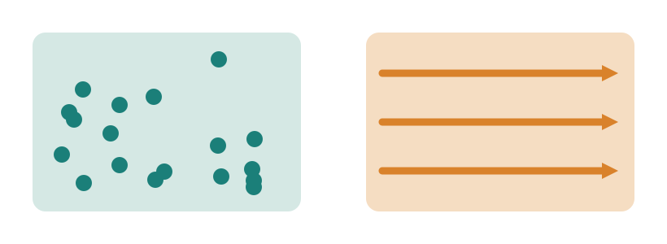
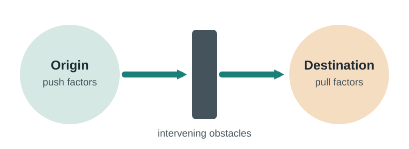
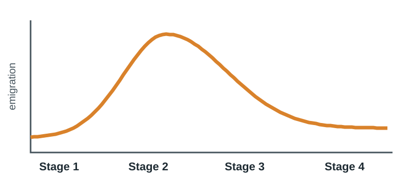
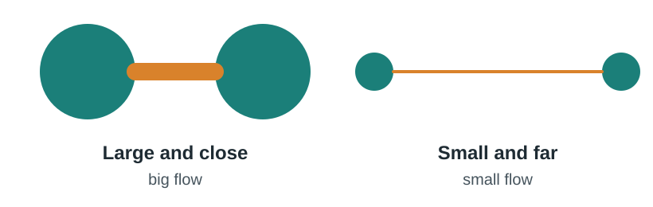
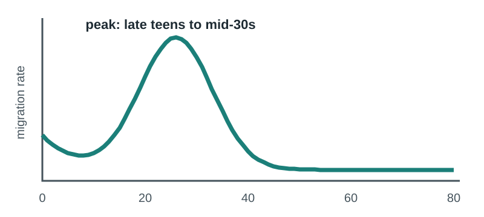

## This week

:::: {.columns}
::: {.column width="32%"}
::: {.card}
**Read**

Chapter 3, Migration

Dobra et al. (2017). Space-time migration patterns and risk of HIV acquisition in rural South Africa
:::
:::
::: {.column width="2%"}
:::
::: {.column width="32%"}
::: {.card}
**Map**

Exercise 3.1 Spatial distributions

Exercise 3.2 Push and pull forces

Exercise 3.3 Refugees
:::
:::
::: {.column width="2%"}
:::
::: {.column width="32%"}
::: {.card .tint}
**Be able to**

Tell migrant stock from migrant flow

Explain migration with push, pull and distance

Treat mobility as a health exposure
:::
:::
::::

::: {.notes}
Welcome to Week 3. Last week we covered births and deaths; this week completes the demographic equation with migration. Read Chapter 3 and the paper by Dobra and colleagues, which uses ACDIS residential histories to link how far and how long people moved to their risk of acquiring HIV. Then complete ArcGIS Online exercises 3.1 to 3.3. By the end of the week you should be able to distinguish migrant stock from migrant flow, explain migration using push and pull factors and distance, and think of mobility as an exposure in public health research.
:::

## People who move carry risk, care and data with them {background-color="#1B7F79" .dark}

Migration shapes who gets infected, who stays in care, and who is missing from a survey.

::: {.notes}
Here is why migration matters for public health. People who move can be exposed to new risks, such as new sexual networks or crowded housing. They can fall out of treatment when they leave the clinic where they were enrolled. And they can disappear from the denominators of surveys that count only residents. If you map disease without thinking about mobility, you can mistake where an infection was acquired, or miss the people at highest risk entirely.
:::

## Migration: a change of permanent or semi-permanent residence

:::: {.columns}
::: {.column width="50%"}
**Immigration** = moving in. **Emigration** = moving out.

Measured at three scales:

- **International**: between countries
- **National**: between regions of a country
- **Local**: rural to urban, or within a district
:::
::: {.column width="50%"}
::: {.card .tint}
**Population change = Births − Deaths + Immigration − Emigration**

Migration is the second half of last week's equation.
:::
:::
::::

::: {.notes}
The chapter defines migration as a change in the location of one’s permanent or semi-permanent residence. Immigration is moving in and emigration is moving out. Migration happens at several scales: international, between countries; national, between regions of one country; and local, such as from a rural village to a nearby town. In southern Africa, a great deal of public health research focuses on local and national moves, especially between rural homes and cities. This is the second half of the demographic equation from last week: population change equals births minus deaths plus immigration minus emigration.
:::

## Stock is who is here. Flow is who moved.

{fig-alt="Migrant stock: everyone living somewhere they were not born. Migrant flow: people moving during a set time period" width="55%"}

:::: {.columns}
::: {.column width="50%"}
**Migrant stock**: people living somewhere they were not born. Recent arrivals and those who came decades ago.
:::
::: {.column width="50%"}
**Migrant flow**: moves during a set period, such as the past year. **Net migration** = in-migrants − out-migrants.
:::
::::

::: {.notes}
The chapter distinguishes two measures. Migrant stock is the number of people living in a place where they were not born. It includes someone who arrived last month and someone who arrived fifty years ago as a child. Migrant flow counts moves within a specific time frame, such as the past year or the past five years. Net migration is the difference between people moving in and people moving out, often expressed per thousand population. For example, the chapter reports US net migration of three point two per thousand between 2010 and 2015, compared with six point seven in Canada. A stock map and a flow map of the same place can tell very different stories, so always check which one you are reading.
:::

## Push, pull and what lies between

{fig-alt="Push factors at the origin and pull factors at the destination, with intervening obstacles such as distance, cost and borders in between" width="50%"}

| Force | Push example | Pull example |
|---|---|---|
| **Economic** | Low wages, unemployment | Jobs, career growth |
| **Social and cultural** | Family conflict, discrimination | Family and friends, shared language |
| **Political** | War, persecution | Safety, rule of law |
| **Environmental** | Drought, disaster | Pleasant climate |

::: {.notes}
Migration theory starts with Ravenstein, whose laws of migration were published in 1885. One correction: later in the chapter the textbook calls him Rubenstein; it means Ravenstein. His ideas led to the push-pull framework. Places of origin have forces that push people to leave and destinations have forces that pull them in. The chapter groups these into economic forces, the most common drivers, such as wage differences; social and cultural forces, such as family networks and shared language; political forces, such as war and persecution; and environmental forces, such as drought and disasters. Between origin and destination lie intervening obstacles: distance, cost, borders, walls, and immigration policy. In exercise 3.2 you will map these forces.
:::

## Forced or voluntary, the line is blurry

:::: {.columns}
::: {.column width="50%"}
::: {.card}
**Refugee**: outside their country owing to a well-founded fear of persecution (1951 UN Refugee Convention)
:::

::: {.card}
**Internally displaced person**: forced from home by conflict, rights violations or disaster, but still inside their own country
:::
:::
::: {.column width="50%"}
**86%** of refugees lived in developing countries, mostly next door to where they fled. That is distance decay.

[**Vulnerability**, the susceptibility to harm, shapes how badly a disaster displaces people: income, age, mobility and gender matter.]{.muted}
:::
::::

::: {.notes}
The chapter separates forced and voluntary migration, while noting the line is often blurry because insecurity and poverty go together. A refugee, under the 1951 UN Refugee Convention, is someone outside their country because of a well-founded fear of persecution for race, religion, nationality, social group or political opinion. Internally displaced people have been forced from home by conflict, rights violations or disaster but have not crossed an international border. A striking fact from the chapter: eighty-six percent of refugees lived in developing countries, usually in countries next to the one they fled. Vulnerability, a person’s or society’s susceptibility to harm, shapes how severe displacement becomes. Exercise 3.3 maps refugee flows.
:::

## Migration rises, then falls, with development

:::: {.columns}
::: {.column width="55%"}
{fig-alt="Migration transition: emigration is low in preindustrial stage 1, peaks as countries industrialize in stage 2, then falls in stages 3 and 4"}
:::
::: {.column width="45%"}
The **migration transition** tracks the demographic transition.

- **Stage 1**: too poor to move
- **Stage 2**: population boom, rural-to-urban migration, emigration peaks
- **Stages 3 and 4**: slower growth, less emigration, more arrivals

[Schematic, after the textbook's figure 3.11]{.small .muted}
:::
::::

::: {.notes}
The migration transition theory links emigration to the demographic transition from last week. In stage one, preindustrial societies have little population pressure and too little income to move far. In stage two, the population booms and incomes start to rise, so there is massive rural-to-urban migration and emigration abroad. In stages three and four, growth slows, emigration falls, and wealthy countries receive more migrants than they send. The chapter uses Mexico as an example: as incomes rose and fertility fell to about two point two, emigration was expected to decline. This curve is a schematic based on the textbook’s figure.
:::

## Distance decay and the gravity model

:::: {.columns}
::: {.column width="50%"}
{fig-alt="Gravity model: two large, close places have a thick flow line between them; two small, distant places have a thin one"}

::: {.card .tint}
**Flow ∝ (population A × population B) ÷ distance**
:::
:::
::: {.column width="50%"}
Most international migration stays in the same region: **52%** of African migrants live in Africa, **60%** of Asian migrants in Asia.

**Cultural distance** matters too: shared language and colonial ties "shorten" the trip.
:::
::::

::: {.notes}
Distance decay from Week 1 is central to migration: the farther apart two places are, the less migration between them, because distance adds cost, time and risk. The chapter notes that most international migration stays within a region: fifty-two percent of African migrants live elsewhere in Africa and sixty percent of Asian migrants elsewhere in Asia. The gravity model adds size: flows are proportional to the populations of the two places and inversely proportional to the distance between them. So large places that are close together exchange many migrants, and small places far apart exchange few. Cultural distance matters as well: a shared language, religion or colonial history increases flows between places that are physically far apart.
:::

## Networks turn pioneers into chains

:::: {.columns}
::: {.column width="33%"}
::: {.card}
**Pioneer migrants**

Young, often single, first to arrive. They send back information.
:::
:::
::: {.column width="33%"}
::: {.card}
**Chain migration**

Friends and family follow, helped with work and housing.
:::
:::
::: {.column width="33%"}
::: {.card}
**Cumulative causation**

Enclaves and remittances make further migration self-sustaining.
:::
:::
::::

**Remittances**, money sent home, can exceed 20% of GDP in some countries and reduce poverty at the origin.

::: {.notes}
Migrants do not choose among all possible destinations. They rely on information, much of it from social networks. Pioneer migrants are the first to arrive, often young and single. They share news about jobs and housing, and friends and family follow in chain migration, helped by those already there. Over time, cumulative causation makes migration self-sustaining: enclaves form, businesses serve the newcomers, and remittances fund more moves. Remittances, money sent home, can be more than twenty percent of GDP in countries such as Haiti and Liberia, and over forty percent in Tajikistan in 2014. In public health, these same networks carry information about health services, and they also connect sexual networks between home and destination.
:::

## Migrants are not a random sample

{fig-alt="Schematic migration rate by age: low in childhood and old age, peaking from the late teens to mid-30s" width="45%"}

**Migrant selectivity:** movers differ from stayers by age, sex, education and household situation. The one near-universal pattern is **age**.

[Schematic. Globally, 72% of migrants are aged 20–64, compared with 58% of the world population.]{.small .muted}

::: {.notes}
The chapter calls this migrant selectivity: except in forced migration, the people who move are not a random sample of where they come from. Sex ratios, education and family situation vary from place to place, but age is the one consistent pattern. People in their late teens to mid-thirties migrate far more than others, for school, work and marriage, and because they have fewer ties such as mortgages. Globally, seventy-two percent of migrants are aged twenty to sixty-four, compared with fifty-eight percent of the world population. For epidemiology, this matters twice: the ages of peak mobility are also the ages of peak HIV risk, and a survey of residents will under-count exactly these young adults.
:::

## Mobility and health

:::: {.columns}
::: {.column width="50%"}
The chapter ends with costs at the origin: families separated for long periods, and higher rates of sexually transmitted infection, including HIV, when partners live apart.

[India's National AIDS Control Organisation runs HIV campaigns aimed at migrant workers.]{.muted}
:::
::: {.column width="50%"}
::: {.card .tint}
**ACDIS HIV survey, 2003–2006:** non-resident men had higher odds of HIV than resident men (adjusted odds ratio **1.8**); for women it was **1.5**.

[Source: Tanser F, et al. Int J Epidemiol. 2008;37(5):956-962]{.small .muted}
:::
:::
::::

::: {.notes}
Near the end, the chapter notes that emigration can damage family cohesion and raise rates of sexually transmitted infections, including HIV, when spouses spend long periods apart. Its example is HIV awareness posters aimed at migrant workers in India. The ACDIS cohort profile from Week 1 gives a local measure. In the first HIV survey rounds, non-resident household members were more likely to be infected: men who lived outside the surveillance area had about one point eight times the odds of having HIV compared with resident men, after adjustment, and the odds ratio for women was one point five. That observation motivates this week’s paper.
:::

## Public health case: how far, and for how long? {background-color="#1E2B33" .dark}

[Dobra et al. 2017 · ACDIS, 2000–2014]{.eyebrow}

:::: {.columns}
::: {.column width="33%"}
[17,743]{.bignum}

HIV-negative adults followed, with every residential move geolocated
:::
::: {.column width="33%"}
[8,006]{.bignum}

Migration events, covering over 1 million km
:::
::: {.column width="33%"}
[107 km]{.bignum}

Median migration distance; 17.4% migrated at least once
:::
::::

[Source: Dobra A, Bärnighausen T, Vandormael A, Tanser F. AIDS. 2017;31(1):137-145. [doi:10.1097/QAD.0000000000001292](https://doi.org/10.1097/QAD.0000000000001292)]{.small}

::: {.notes}
This week’s paper uses something few studies have: the complete, geolocated residential history of every person in a cohort. Dobra and colleagues followed seventeen thousand seven hundred forty-three adults who were HIV-negative at the start, between 2000 and 2014. They geolocated eight thousand and six migration events, which together covered more than one million kilometres. Seventeen point four percent of participants migrated outside the rural study area at least once, and the median distance moved was about one hundred seven kilometres. From these histories they built two time-varying measures: how far people moved, and how much of their time they spent outside the community.
:::

## Short moves carried substantial risk {background-color="#1E2B33" .dark}

:::: {.columns}
::: {.column width="50%"}
::: {.card}
**Distance:** HIV acquisition risk rose by **50%** at migration distances of **40 km** for men and **109 km** for women.
:::
:::
::: {.column width="50%"}
::: {.card}
**Time away:** risk rose by **50%** when men spent **44%**, and women **90%**, of their time outside the community.
:::
:::
::::

The relationship was **nonlinear**: even relatively short moves added substantial risk. Distance and time away are both spatial exposures you can calculate in a GIS.

::: {.notes}
Both migration measures strongly predicted HIV acquisition in men and women. Holding other factors equal, the risk of acquiring HIV rose by fifty percent at a migration distance of forty kilometres for men and one hundred nine kilometres for women. Risk also rose by fifty percent when men spent forty-four percent of their time outside the community, and when women spent ninety percent. The relationship was nonlinear, and the authors stress that even relatively short moves carried substantial added risk. For this course, notice the method. Distance and time spent away are spatial exposures built from geocoded addresses, the same kind of distance measurement you practised in Week 1.
:::

## Beyond the textbook: mapping flows

:::: {.columns}
::: {.column width="50%"}
**Origin–destination (OD) data**: one row per move, with origin, destination and a count.

**Flow lines** connect origins to destinations; line width shows volume.

**Distance per move** comes from the two coordinates, so you can classify short versus long moves.
:::
::: {.column width="50%"}
::: {.card .tint}
In ArcGIS Online: **Analysis → Connect Origins to Destinations** draws lines and measures distance or travel time. Analysis tools use credits.
:::

[Step-by-step instructions are on the handout.]{.small .muted}
:::
::::

::: {.notes}
This slide goes beyond the textbook. Migration data usually come as origin-destination tables: one row per move or per pair of places, with the origin, the destination and a count. A flow map connects each origin to its destination with a line whose width shows the volume, the flowline map type from Week 1. Once you have both coordinates, you can also calculate the distance of each move and classify moves as short or long, just as Dobra and colleagues did. In ArcGIS Online, the Connect Origins to Destinations analysis tool draws these lines and measures straight-line distance or travel time. Analysis tools consume credits, so run them on small datasets first. The steps are on the handout.
:::

## Questions to ask any migration map {background-color="#1B7F79" .dark}

:::: {.columns}
::: {.column width="50%"}
1. Stock or flow? Over what period?
2. Counts, rates or net migration?
3. Which scale: international, national or local?
:::
::: {.column width="50%"}
4. Who is missing: non-residents, the undocumented?
5. Where was the exposure: home or destination?
6. Is distance straight-line or travel time?
:::
::::

::: {.notes}
Here are six questions for any migration map. Is it showing stock or flow, and over what period? Counts, rates or net migration? At which scale? Who is missing from the data, such as non-resident members or undocumented migrants? If it is a health map, where was the exposure, at home or at the destination? And is distance measured as a straight line or as travel time? These are on your handout.
:::

## Your Week 3 tasks

| Task | Where |
|---|---|
| Read Chapter 3 | Textbook |
| Read Dobra et al. (2017) | [Readings page](../../readings.qmd) |
| Exercises 3.1, 3.2 and 3.3 | ArcGIS Online |
| Reading check | Canvas |

**Optional practice:** Exercise 3.4 Does immigration increase unemployment? **Exercise links:** [esri.com/Human-Geography](https://www.esri.com/Human-Geography). Due dates are in Canvas.

::: {.notes}
Before Week 4, read Chapter 3 and Dobra and colleagues, complete exercises 3.1 to 3.3 in ArcGIS Online, and complete the reading check in Canvas. Exercise 3.4, on immigration and unemployment, is optional extra practice. Keep the Week 3 handout nearby for the definitions and the flow-mapping steps.
:::
