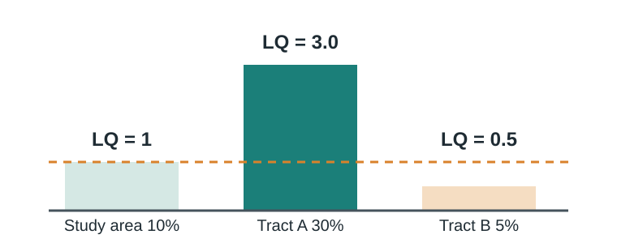
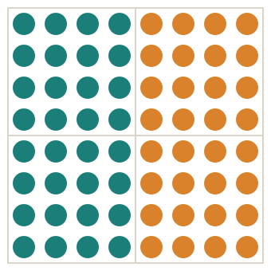
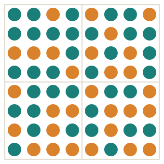
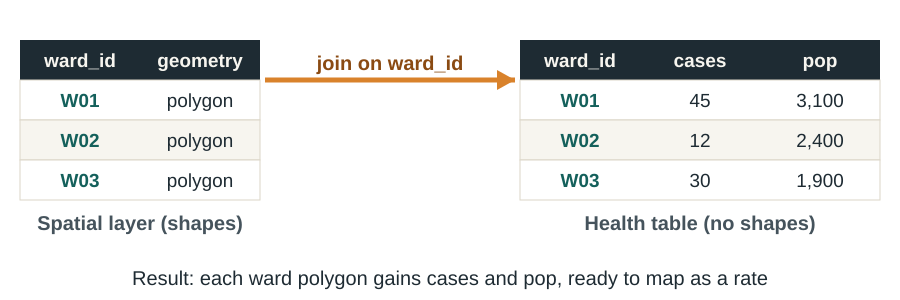
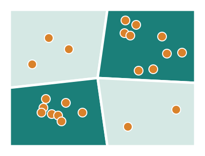
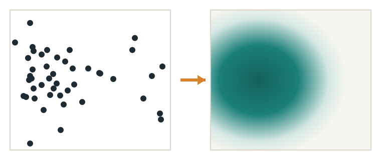

## This week

:::: {.columns}
::: {.column width="32%"}
::: {.card}
**Read**

Chapter 4, Race and ethnicity

Tanser et al. (2009). Localized spatial clustering of HIV infections in a widely disseminated rural South African epidemic
:::
:::
::: {.column width="2%"}
:::
::: {.column width="32%"}
::: {.card}
**Map**

Exercise 4.1 Population ratios

Exercise 4.2 Location quotient

Exercise 4.4 Income, race and ethnicity

Exercise 4.5 Environmental justice
:::
:::
::: {.column width="2%"}
:::
::: {.column width="32%"}
::: {.card .tint}
**Be able to**

Calculate a location quotient

Interpret an index of dissimilarity

Join a health table to a map by its key
:::
:::
::::

::: {.notes}
Welcome to Week 4. This week is about measuring disparities: how groups are distributed across space, how segregated they are, and how that relates to health. Read Chapter 4 and Tanser and colleagues’ 2009 paper, which finds local HIV hot spots inside an epidemic that looks uniformly high. Then complete exercises 4.1, 4.2, 4.4 and 4.5. You will also learn a core GIS skill the textbook skips: joining a table of health data to a map using a shared key. By the end of the week you should be able to calculate a location quotient, interpret an index of dissimilarity, and perform a table join.
:::

## Disparities are spatial before they are statistical {background-color="#1B7F79" .dark}

Where people live shapes their exposures, their services and their risks. Mapping groups is how we find inequity.

::: {.notes}
The chapter argues that geographers map race and ethnicity not just to know where groups live, but to understand how location relates to quality of life: income, housing, crime, environmental hazards and health. For public health, this is the foundation of health equity work. Before you can test whether a group bears more disease, you usually need to know where that group lives and what conditions surround them. Disparities often appear on a map first.
:::

## Race and ethnicity are social categories

:::: {.columns}
::: {.column width="33%"}
::: {.card}
**Ethnicity**

Shared cultural heritage: language, beliefs, food, traditions, an ancestral homeland
:::
:::
::: {.column width="33%"}
::: {.card}
**Race**

Grouping traditionally based on physical traits such as skin colour
:::
:::
::: {.column width="33%"}
::: {.card}
**Nationality**

The nation a person belongs or belonged to
:::
:::
::::

Both race and ethnicity are **socially constructed**: categories made by people, not fixed biological groups. So the categories, and the data, change over time and between countries.

::: {.notes}
The chapter defines ethnicity as a shared cultural heritage, including language, beliefs, food, traditions and an ancestral homeland. Race has traditionally been tied to physical traits such as skin colour, and racial classification grew with European colonialism and early taxonomy. Nationality is different again: the nation a person belongs or belonged to. An ethnic Chinese person may never have lived in China. The key point is that race and ethnicity are socially constructed. They are not fixed biological categories, which is why the categories in our data change over time and differ from country to country. In health research, race is a marker of social experience, including exposure to racism, rather than of biology.
:::

## The categories in the data keep changing

:::: {.columns}
::: {.column width="50%"}
**United States census**

- Before 1960, census takers assigned race; since 1960, people **self-identify**
- Since 2000, people can choose **more than one race**
- Hispanic origin is a **separate question**, so analysts often map "non-Hispanic white"
:::
::: {.column width="50%"}
**Other countries**

- Brazil has counted "mixed" since **1872**
- France collects **no** race or ethnicity data for those born French
- South Africa's census records **population group**: Black African, Coloured, Indian or Asian, White

[South Africa row: beyond the textbook]{.small .muted}
:::
::::

::: {.notes}
Because the categories are social, the data reflect each country’s history. In the US census, enumerators assigned people’s race until 1960; since then people self-identify. Until 1990 you could choose only one race; since 2000 you can choose more than one. Hispanic or Latino origin is asked as a separate question, so a Hispanic person also picks a race, and analysts often map non-Hispanic white rather than all white. Other countries differ. Brazil has had a mixed category since 1872. France collects no race or ethnicity data for people born French, which makes inequality harder to study. Going beyond the textbook, South Africa’s census records population group, with categories that grew out of apartheid-era classification. When you map any of these variables, the metadata question from Week 1 applies: how was this category defined, and who chose it?
:::

## Scale changes the picture again

:::: {.columns}
::: {.column width="33%"}
::: {.card}
**State**

Regional patterns and immigration gateways
:::
:::
::: {.column width="33%"}
::: {.card}
**County**

Urban versus rural differences within a state
:::
:::
::: {.column width="33%"}
::: {.card}
**Census tract**

Neighbourhood clustering and segregation (about 2,500–8,000 people)
:::
:::
::::

**Counts versus rates, again:** New York and Texas have lower *percentages* of Black residents than Louisiana and Alabama, but larger *numbers*.

::: {.notes}
The chapter maps each major US group at three scales, and each scale shows a different process. States show broad regional patterns and immigration gateways. Counties reveal urban and rural differences within a state: for example, the Hispanic population of California is concentrated in the south and the Central Valley. Census tracts, small units of about two thousand five hundred to eight thousand people, show neighbourhood clustering and segregation. This is the modifiable areal unit problem from Week 1 again. The chapter also repeats the counts-versus-rates lesson: New York and Texas have lower percentages of Black residents than Louisiana and Alabama, but larger absolute numbers. Which map you need depends on your question.
:::

## How groups settle

| Pattern | What it is |
|---|---|
| **Ethnic enclave** | A neighbourhood of a relatively homogeneous group, with businesses and signs that serve it |
| **Ethnoburb** | An ethnic community in a suburb, rather than the inner city |
| **Spatial assimilation** | A group disperses as it blends with the wider society |
| **Heterolocal** | A group lives dispersed but stays connected through institutions and media |

[Census data can miss heterolocal groups. Fieldwork on the **cultural landscape** can find them.]{.muted}

::: {.notes}
The chapter describes several settlement patterns. Ethnic enclaves are neighbourhoods dominated by one group, with businesses, signs and festivals that serve it, like Chinatowns. Ethnoburbs are similar communities in the suburbs. Spatial assimilation is the process by which a group disperses as it blends into the wider society, as happened with most early twentieth-century European immigrant groups. A heterolocal group lives spread out but stays connected through institutions, businesses and media. For public health outreach, these patterns matter: an enclave can be reached with place-based services, while a heterolocal community needs network-based approaches.
:::

## The location quotient

:::: {.columns}
::: {.column width="50%"}
::: {.card .tint}
**LQ** = (group in tract ÷ total in tract) ÷ (group in study area ÷ total in study area)
:::

- **LQ = 1**: same share as the study area
- **LQ > 1**: over-represented; LQ = 2 means twice the share
- **LQ < 1**: under-represented
:::
::: {.column width="50%"}
{fig-alt="Location quotient: a tract with 30% of a group where the study area has 10% has LQ 3; a tract with 5% has LQ 0.5"}
:::
::::

[Because LQ is standardized, you can compare different groups and different years. Practise in **Exercise 4.2**.]{.muted}

::: {.notes}
The location quotient is a simple, powerful measure of concentration. Divide the group’s share in a small area, such as a census tract, by its share in the whole study area. A value of one means the tract has the same share as the region. Above one means over-representation; two means twice the regional share. Below one means under-representation. In the example, the group is ten percent of the study area. A tract where it is thirty percent has a location quotient of three; a tract where it is five percent has one half. The chapter’s example is Somali residents in Minneapolis, with tracts at twenty to thirty-four times the state share. Because the measure is standardised, you can compare different groups or years, which a raw percentage map cannot do. Economists use the same formula for industries, and in health it works for anything with a share: cases, clinics, or uninsured residents.
:::

## The index of dissimilarity

:::: {.columns}
::: {.column width="28%"}
{fig-alt="Segregated city: the two groups live in separate halves, index of dissimilarity near 100"}

**Near 100**: segregated
:::
::: {.column width="28%"}
{fig-alt="Integrated city: the two groups are mixed throughout, index of dissimilarity near 0"}

**Near 0**: integrated
:::
::: {.column width="44%"}
The share of one group that would have to move for both groups to be spread evenly across tracts.

| US metro areas | Black–white index |
|---|---|
| Peak, 1960–1970 | 79 |
| 2010 | 59 |
| Detroit, Milwaukee, New York (2010) | over 79 |
| Las Vegas (2010) | under 36 |
:::
::::

::: {.notes}
The index of dissimilarity measures how evenly two groups are spread across the tracts of a city. It runs from zero, perfect integration, to one hundred, total segregation, and it equals the percentage of one group that would have to move for both groups to be distributed evenly. The two diagrams show the extremes: on the left the groups live in separate halves; on the right they are mixed. Black–white segregation in US metropolitan areas peaked at seventy-nine in 1960 and 1970 and fell to fifty-nine by 2010. Detroit, Milwaukee and New York were still above seventy-nine in 2010, while Las Vegas was below thirty-six. Hispanic–white and Asian–white segregation were lower, at about forty-eight and forty-one in 2010.
:::

## Segregation was built, in part, by policy

:::: {.columns}
::: {.column width="50%"}
- **White flight** and **tipping points**
- **Restrictive covenants**: unenforceable after a 1948 Supreme Court ruling
- **Racial steering** and **blockbusting** by real estate agents
- **Redlining**: neighbourhoods graded A to D for mortgage risk, from the 1930s
:::
::: {.column width="50%"}
::: {.card .tint}
The 1968 **Fair Housing Act** banned discrimination in selling and renting, but the footprints of these policies remain on today's maps.
:::

[Income differences and preferences to live near one's own group also sort neighbourhoods.]{.muted}
:::
::::

::: {.notes}
The chapter explains that segregation has several causes, several of them deliberate. White flight was whites leaving neighbourhoods as Black families arrived, sometimes accelerating at a tipping point. Restrictive covenants barred sale or rental to people by race, ethnicity or religion; the Supreme Court ruled them unenforceable in 1948, and the Fair Housing Act of 1968 banned discrimination in selling and renting. Real estate agents steered clients to neighbourhoods of their own race, and used blockbusting to play on fears of change. From the 1930s, federal mortgage maps graded neighbourhoods from A to D, and lending was discouraged in the lowest-graded, often minority, areas: redlining. The chapter also notes that income differences and preferences to live near one’s own group still sort people. Many health studies today find that historically redlined areas still differ in exposures and outcomes. One historical correction: the chapter says slavery ended in 1876. It ended in 1865 with the Thirteenth Amendment.
:::

## Place itself shapes outcomes

:::: {.columns}
::: {.column width="50%"}
::: {.card}
**Moving to opportunity**

Families given vouchers to move to low-poverty neighbourhoods: their children earned more as adults, most of all those who moved young.
:::
:::
::: {.column width="50%"}
::: {.card}
**Environmental justice**

Polluting facilities are more often sited near low-income, frequently minority, neighbourhoods. US federal policy has addressed this since 1994.
:::
:::
::::

[The chapter's Detroit examples: a waste incinerator linked to odour and asthma complaints, a park closed by contaminated soil, and household water shutoffs. Explore this in **Exercise 4.5**.]{.muted}

::: {.notes}
The chapter gives two examples of why place matters. In a housing voucher programme, families moved from poor neighbourhoods to low-poverty neighbourhoods. Nothing changed except the neighbourhood, yet their children earned significantly more as adults, especially those who moved young. That is evidence that neighbourhoods affect life outcomes, not just that different people live in different places. The second example is environmental justice: polluting factories, landfills and incinerators are more often placed near low-income, frequently minority, communities. The US government adopted an environmental justice policy in 1994. The chapter’s Detroit examples include a waste incinerator linked to complaints of odour and high asthma rates, a riverfront park closed because of contaminated soil, and water shutoffs for unpaid bills. Exercise 4.5 has you map an environmental justice question.
:::

## Beyond the textbook: joining tables by a key

{fig-alt="Attribute join: a ward polygon layer and a health table without shapes are linked by the shared key ward_id" width="72%"}

:::: {.columns}
::: {.column width="50%"}
**Key**: a column that uniquely identifies each row, such as a ward code. Both tables must use the same codes and the same format.
:::
::: {.column width="50%"}
**Normalization**: store each fact once, in its own table, and link tables by keys. Join when you need them together.
:::
::::

::: {.notes}
Here is the core GIS skill of the week, which the textbook does not cover. Health data usually arrive as a table without shapes: cases and population by ward or district. To map them, you join the table to a layer of boundaries using a shared key, a column that uniquely identifies each area, such as a ward code. After the join, each polygon carries the health columns, and you can calculate and map a rate. Joins fail quietly when keys do not match exactly: leading zeros dropped by a spreadsheet, extra spaces, or different capitalisation. Always check how many rows matched. This also connects to database normalisation, one of our course objectives: store each fact once in its own table, keep tables linked by keys, and join them only when you need them together. That avoids having the same population figure typed in several places with different values.
:::

## Two ways to join

:::: {.columns}
::: {.column width="50%"}
::: {.card}
**Attribute join**: match rows by a **shared key**.

Ward table → ward polygons, using ward_id.
:::

::: {.card}
**Spatial join**: match features by **location**.

Count the case points that fall inside each ward.
:::

[In ArcGIS Online: Analysis → Join Features does both. It uses credits. Steps are on the handout.]{.small .muted}
:::
::: {.column width="50%"}
{fig-alt="Spatial join: case points are counted inside each ward polygon by location, and wards with more points are shaded darker"}
:::
::::

::: {.notes}
There are two kinds of join. An attribute join matches rows using a shared key, as on the last slide. A spatial join matches features by where they are: for example, counting how many case points fall inside each ward polygon, then shading wards by the count, or better, by the count divided by population. In ArcGIS Online, the Join Features analysis tool does both, depending on the options you choose, and it uses credits. The handout gives the steps. With these two joins you can turn almost any health table or point dataset into a rate map.
:::

## Public health case: HIV hot spots in a high-prevalence area {background-color="#1E2B33" .dark}

[Tanser et al. 2009 · ACDIS HIV survey]{.eyebrow}

:::: {.columns}
::: {.column width="33%"}
[12,221]{.bignum}

People tested for HIV, each linked to a homestead located to under 2 m
:::
::: {.column width="33%"}
[6–36%]{.bignum}

Range of local HIV prevalence within one "relatively homogeneous" population
:::
::: {.column width="33%"}
[3 km]{.bignum}

Radius of the kernel used to estimate prevalence across continuous space
:::
::::

[Source: Tanser F, Bärnighausen T, Cooke GS, Newell ML. Int J Epidemiol. 2009;38(4):1008-1016. [doi:10.1093/ije/dyp148](https://doi.org/10.1093/ije/dyp148)]{.small}

::: {.notes}
This week’s paper takes the clustering idea and applies it to HIV. Tanser and colleagues linked all twelve thousand two hundred twenty-one people who consented to an HIV test to their homesteads, each located with GPS to under two metres. The surveillance population is relatively homogeneous: almost entirely isiZulu-speaking, mostly rural. Yet local HIV prevalence ranged from six to thirty-six percent. To estimate prevalence smoothly across the area without drawing arbitrary boundaries, they used a kernel with a three-kilometre radius, which avoids the modifiable areal unit problem. Then they formally tested for clusters.
:::

## Clusters along the national road {background-color="#1E2B33" .dark}

:::: {.columns}
::: {.column width="50%"}
{fig-alt="Kernel smoothing: individual homestead points on the left become a continuous prevalence surface on the right, darkest where cases concentrate"}

[Schematic of kernel smoothing]{.small}
:::
::: {.column width="50%"}
::: {.card}
**Kulldorff spatial scan statistic** found **3 high-risk clusters** along the national road (relative risk 1.34–1.62) and **3 low-risk clusters** elsewhere (relative risk 0.20–0.38).
:::

The authors call for interventions that target the communities at greatest risk, alongside population-wide measures.
:::
::::

::: {.notes}
Two techniques work together here. Kernel smoothing, sketched on the left, turns individual points into a continuous surface: for each location it averages the people within three kilometres, so you see a prevalence surface rather than a choropleth of arbitrary units. Then the Kulldorff spatial scan statistic tests whether any circular area has more or fewer cases than expected by chance, the formal version of hot spot analysis from Week 1. It found three overlapping high-risk clusters along the national road, with relative risks of one point three four to one point six two, and three low-risk clusters elsewhere, with relative risks of point two to point three eight. Even in a generalised epidemic, then, there are localised epidemics of different intensity. The authors argue for targeting the highest-risk communities, alongside measures aimed at everyone.
:::

## Questions to ask any disparity map {background-color="#1B7F79" .dark}

:::: {.columns}
::: {.column width="50%"}
1. Who defined the categories, and how?
2. Share, count, LQ or dissimilarity?
3. At which scale: state, county or tract?
:::
::: {.column width="50%"}
4. Did every row join? How many were dropped?
5. Is a cluster tested, or just eyeballed?
6. What history produced this pattern?
:::
::::

::: {.notes}
To wrap up, six questions for any map of disparities. Who defined the categories, and how? Is the map showing a share, a count, a location quotient or a dissimilarity index? At which scale? If data were joined, did every row match, and how many were dropped? Is a cluster tested statistically, or just eyeballed? And what history, including policy, produced the pattern you see? These are on your handout.
:::

## Your Week 4 tasks

| Task | Where |
|---|---|
| Read Chapter 4 | Textbook |
| Read Tanser et al. (2009) | [Readings page](../../readings.qmd) |
| Exercises 4.1, 4.2, 4.4 and 4.5 | ArcGIS Online |
| Reading check | Canvas |

**Optional practice:** Exercises 4.3 Tapestry segmentation and 4.6 The cultural landscape. **Exercise links:** [esri.com/Human-Geography](https://www.esri.com/Human-Geography). Due dates are in Canvas.

::: {.notes}
Before Week 5, read Chapter 4 and Tanser and colleagues, complete exercises 4.1, 4.2, 4.4 and 4.5 in ArcGIS Online, and complete the reading check in Canvas. Exercises 4.3 and 4.6 are optional extra practice. The Week 4 handout has the location quotient and dissimilarity formulas and the steps for joining tables.
:::
