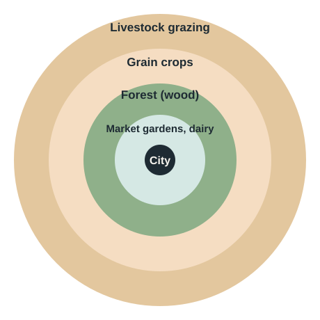
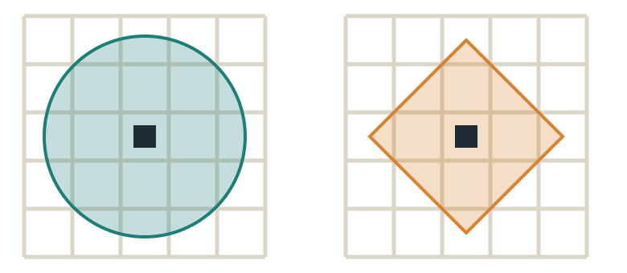
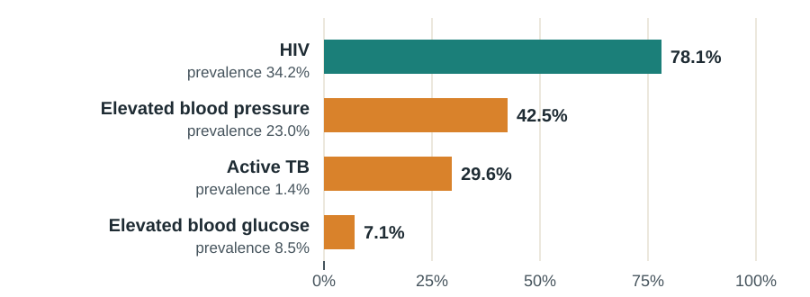

## This week

:::: {.columns}
::: {.column width="32%"}
::: {.card}
**Read**

Chapter 6, Food and agriculture

Wong et al. (2021). Convergence of infectious and non-communicable disease epidemics in rural South Africa
:::
:::
::: {.column width="2%"}
:::
::: {.column width="32%"}
::: {.card}
**Map**

Exercise 6.4 Food deserts and racial disparities

Exercise 6.5 Undernourishment and development
:::
:::
::: {.column width="2%"}
:::
::: {.column width="32%"}
::: {.card .tint}
**Be able to**

Define food security and food deserts

Measure access with buffers and travel time

Explain the double burden of disease
:::
:::
::::

::: {.notes}
Welcome to Week 5. This week moves from people to food: how agriculture is organised across space, why hunger persists when there is enough food, and how we measure access to healthy food. Read Chapter 6 and Wong and colleagues’ 2021 paper from the Vukuzazi study, which found HIV, tuberculosis, high blood pressure and diabetes overlapping in the same rural population. Then complete exercises 6.4 and 6.5. The GIS skill this week, beyond the textbook, is access analysis with buffers and travel-time areas.
:::

## There is more food than ever, yet hunger and diet-related disease persist {background-color="#1B7F79" .dark}

Food security is about access and quality, not just supply.

::: {.notes}
The chapter’s central puzzle is this: world food supply per person has grown faster than population, and the share of people undernourished has fallen, yet hunger persists in some places, and in wealthier places people suffer from poor diets instead. The answer is that food security depends on whether people can reach and afford nutritious food, not just whether enough food exists somewhere. That makes it a spatial question, and a GIS question.
:::

## Three agricultural revolutions

| Revolution | When | What changed |
|---|---|---|
| **First** | From about 9000 BCE | Domestication of plants and animals in several hearths; settled villages, then cities |
| **Second** | About 1750–1880 | Crop rotation, enclosure, machinery and purchased inputs; food for industrial cities |
| **Green revolution** | Second half of the 1900s | High-yield seeds, fertilizers, irrigation; later genetically modified crops |

[Without the green revolution, food prices in 2000 would have been an estimated 66% higher.]{.muted}

::: {.notes}
The chapter traces three agricultural revolutions. The first began around 9000 BCE, when people in several separate hearths, the Fertile Crescent, China, Mesoamerica, South America, West Africa and the Ethiopian highlands, domesticated plants and animals. Food surpluses allowed denser settlements, specialisation and eventually cities. The second, from about 1750 to 1880 alongside the Industrial Revolution, brought crop rotation, private enclosed farms, machinery and purchased inputs, producing food for industrial workers. The green revolution in the second half of the twentieth century bred high-yield crops that respond to fertiliser and irrigation, and more recently genetically modified crops. The chapter cites an estimate that without it, food prices in 2000 would have been sixty-six percent higher. It also notes the criticism that these technologies favoured large landowners who could afford the inputs.
:::

## The Columbian exchange reshaped what the world eats

:::: {.columns}
::: {.column width="50%"}
::: {.card}
**From the Americas:** potatoes, maize, tomatoes, chili peppers, cacao, tobacco
:::
:::
::: {.column width="50%"}
::: {.card}
**To the Americas:** sugarcane, coffee, soybeans, oranges, bananas
:::
:::
::::

Plantations for export crops in the Americas were worked by **enslaved Africans** and indentured labourers. Diseases crossed with the crops.

[Textbook corrections: the potato reached Ireland *from* the Americas, and the chili peppers in curries are New World crops.]{.small .muted}

::: {.notes}
After 1492, the Columbian exchange moved crops, animals, people and diseases between the hemispheres. Potatoes, maize, tomatoes, chili peppers and cacao went from the Americas to the rest of the world; sugarcane, coffee, soybeans and bananas went the other way. Two corrections to the textbook here. It says Old World to New World diffusion explains Ireland’s potato; in fact the potato is a New World crop that travelled to Europe. And it calls the peppers in Indian curries Old World peppers; chili peppers are also from the Americas. The chapter notes something that matters greatly: the plantations built to grow these export crops relied on large numbers of enslaved Africans and indentured servants. The exchange increased food supply and diversity, and it was built partly on forced labour. We return to this on the critical lens slide.
:::

## How farming is organized

| Type | Goal | Inputs | Examples |
|---|---|---|---|
| **Commercial agribusiness** | Sell to national and global markets | Much capital and/or labour | Plantations, grain farming, ranching, dairy |
| **Commercial smallholder** | Sell, on a small scale | Limited capital | Mixed farming, Mediterranean agriculture |
| **Subsistence** | Feed the household | Labour, little capital | Nomadic herding, shifting cultivation, paddy rice |

**Intensive** = high yield per area. **Extensive** = low yield, large areas. **Comparative advantage**: each place specializes in what it produces most efficiently, then trades.

::: {.notes}
The chapter arranges farming along a continuum from commercial to subsistence. Large commercial agribusinesses sell to national and global markets using heavy capital, labour or both: plantations of tea, coffee or cocoa, large grain farms, ranches and dairies. Commercial smallholders sell their output too, but on small farms with limited capital, often with mixed crops and livestock to spread risk. Subsistence farmers grow mainly for their own household: nomadic herding, shifting or slash-and-burn cultivation, and intensive paddy rice. Intensive farming gets high yields from small areas; extensive farming uses large areas at low yields. And comparative advantage explains regional specialisation: California grows almonds, Idaho potatoes, and they trade.
:::

## Von Thünen: distance shapes land use

:::: {.columns}
::: {.column width="40%"}
{fig-alt="Von Thunen model: rings around a city, from market gardens and dairy closest, then forest, grain crops, and livestock grazing farthest out"}
:::
::: {.column width="60%"}
Johann Heinrich von Thünen (1826): land use forms rings around a market, set by **revenue per area**, **land cost** and **transport cost**.

- Perishable, high-value goods close in: vegetables, milk
- Heavy goods next: wood
- Grain farther out; grazing farthest

[Refrigeration and global trade weaken the model, but it still describes places with poor transport, and modern farmers' markets.]{.muted}
:::
::::

::: {.notes}
Von Thünen’s 1826 model is one of the founding ideas of economic geography, and it is fundamentally about distance. Land close to a market is more accessible, so it is more valuable. Each farm product earns different revenue per area and costs differently to transport. The result is rings: perishable, high-value goods like vegetables and milk closest to the city; then forest for heavy fuelwood and timber; then grain; and livestock grazing farthest out. Refrigeration and global shipping have weakened the model, but the chapter notes it still describes poorer places with limited transport and refrigeration, which is relevant to rural food access in our case study.
:::

## Food security has more than one dimension

:::: {.columns}
::: {.column width="50%"}
**Hunger**: a prolonged lack of food, seen in stunting and underweight.

**Food security**: reliable access to enough food, of the **quality and diversity** needed for a healthy diet.
:::
::: {.column width="50%"}
::: {.card .tint}
**Most hunger is about access.** Poverty is the strongest cause. Conflict and disasters disrupt farming and markets. Climate change is expected to cut cereal yields in sub-Saharan Africa.
:::
:::
::::

[Over 40% of people in Middle Africa and over 30% in East Africa were undernourished. About a third of all food produced is lost or wasted.]{.muted}

::: {.notes}
The chapter distinguishes hunger, a prolonged lack of food that shows up as stunted and underweight children, from food security, a broader idea that includes access to enough food of the quality and diversity needed for health. Most hunger today is about access rather than supply, and poverty is the strongest cause, creating a cycle in which undernourished people are less productive and stay poor. Protracted crises, conflict and disasters disrupt farms and markets, as in South Sudan and Haiti, and climate change is expected to reduce cereal yields in sub-Saharan Africa. The chapter reports undernourishment above forty percent in Middle Africa and above thirty percent in East Africa, and estimates that about one third of all food produced is lost or wasted.
:::

## Food deserts: low income plus low access

:::: {.columns}
::: {.column width="50%"}
The textbook's definition, from US data: census tracts where at least **100 households** are low income, have **no vehicle**, and are more than **half a mile** from a supermarket.

[In 2015, 5% of US households had very low food security and 7.7% low food security.]{.muted}
:::
::: {.column width="50%"}
::: {.card}
**Access is not the whole story.** When supermarkets open in former food deserts, diets do not always change: cost, habits and knowledge matter too.
:::
:::
::::

Practise mapping food deserts in **Exercise 6.4**.

::: {.notes}
In wealthier countries, food insecurity is more often about poor nutrition than too few calories. The chapter defines food deserts as places where low income and low access combine: in its New Orleans example, census tracts where at least one hundred households are low income, lack a vehicle, and are more than half a mile from a supermarket. Residents rely on convenience stores and fast food, which are less nutritious and often more expensive. The chapter adds an important caution: opening a supermarket does not always change diets, because unhealthy food is cheaper per calorie and eating habits are shaped by knowledge and routine. Access is necessary but not sufficient. Exercise 6.4 has you map food deserts and their relationship to race.
:::

## Beyond the textbook: measuring access

{fig-alt="A straight-line buffer is a circle around the supermarket; a network or drive-time area follows the street grid and is a smaller, diamond-like shape" width="50%"}

:::: {.columns}
::: {.column width="50%"}
**Buffer** (teal): everything within a straight-line distance. Quick, but overstates access.
:::
::: {.column width="50%"}
**Travel-time area** (orange): everything reachable along roads in a set time. More realistic.
:::
::::

[In ArcGIS Online: Analysis → Create Buffers, or Create Drive-Time Areas (walking or driving). Both use credits.]{.small .muted}

::: {.notes}
Here is the GIS skill of the week. To measure access, you draw an area around each facility, a supermarket or a clinic, and ask who lives inside it. A buffer, shown in teal, includes everything within a straight-line distance, such as half a mile. It is fast but overstates access, because people travel along roads. A travel-time or drive-time area, shown in orange, includes only what can be reached along the street network in a given time, by walking or driving. It is more realistic, and it connects to cost distance from Week 1. In ArcGIS Online, Create Buffers and Create Drive-Time Areas do this; both use credits. Once you have the areas, you overlay population to count how many people, or how many households without vehicles, fall outside them.
:::

## Public health case: four epidemics in one population {background-color="#1E2B33" .dark}

[Wong et al. 2021 · Vukuzazi, uMkhanyakude district, 2018–2019]{.eyebrow}

:::: {.columns}
::: {.column width="33%"}
[17,118]{.bignum}

Adolescents and adults aged 15 and over screened at mobile health camps
:::
::: {.column width="33%"}
[52.1%]{.bignum}

Had at least one active disease
:::
::: {.column width="33%"}
[23.0%]{.bignum}

Had elevated blood pressure, and 8.5% elevated blood glucose
:::
::::

[Source: Wong EB, Olivier S, Gunda R, et al. Lancet Glob Health. 2021;9(7):e967-e976. [doi:10.1016/S2214-109X(21)00176-5](https://doi.org/10.1016/S2214-109X(21)00176-5)]{.small}

::: {.notes}
This week’s paper comes from Vukuzazi, which means wake up and know yourself in isiZulu. Between May 2018 and November 2019, mobile health camps in the same surveillance area screened seventeen thousand one hundred eighteen adolescents and adults for HIV, tuberculosis, high blood pressure and diabetes, using questionnaires, blood pressure measurement, chest X-rays, and blood and sputum tests. Fifty-two point one percent had at least one active disease. Thirty-four point two percent had HIV, twenty-three percent had elevated blood pressure, eight point five percent had elevated blood glucose, one point four percent had active tuberculosis, and twenty-one point eight percent had had tuberculosis at some point. Non-communicable diseases linked to diet now sit alongside the infectious epidemics in a rural, low-income setting.
:::

## HIV care worked. The other conditions lagged. {background-color="#1E2B33" .dark}

:::: {.columns}
::: {.column width="60%"}
{fig-alt="Vukuzazi: share of people with each condition who were treated with optimal control. HIV 78.1%, elevated blood pressure 42.5%, active TB 29.6%, elevated blood glucose 7.1%"}

[Share of people with each condition who had appropriate treatment and optimal control]{.small}
:::
::: {.column width="40%"}
Prevalence also differed by sex, by age and **geographically**. Women over 50 had a rising burden of multiple, poorly controlled non-communicable diseases.

The authors call for **multidisease care** that builds on the HIV programme.
:::
::::

::: {.notes}
The striking finding is how differently the conditions were managed. Seventy-eight point one percent of people with HIV had appropriate treatment and good control, a result of years of investment in HIV testing and treatment. For elevated blood pressure the figure was forty-two point five percent, for active tuberculosis twenty-nine point six percent, and for elevated blood glucose only seven point one percent. Disease patterns differed by sex, age and geography: men had more tuberculosis, women aged thirty to forty-nine had very high HIV prevalence, and women over fifty had a growing burden of multiple, poorly controlled non-communicable diseases. The authors argue for multidisease care that extends the HIV programme’s successes. For our purposes, the paper’s geospatial maps show where these overlapping needs concentrate, which is exactly where access analysis can guide services.
:::

## Critical lens: food, land and power

:::: {.columns}
::: {.column width="50%"}
::: {.card}
**Colonial agriculture**

Plantation economies were built on enslaved and indentured labour. Many former colonies still depend on a single export crop: over half of crop and livestock export revenue came from tobacco in Zimbabwe and cocoa in Ghana (2013).
:::
:::
::: {.column width="50%"}
::: {.card}
**Land dispossession in South Africa**

The 1913 Natives Land Act restricted Black land ownership to about 7% of the country. Crowded reserves left rural households with little farmland, which shapes food security in places like our study area today.
:::
:::
::::

[Some advocates use **"food apartheid"** instead of "food desert", to name the policies that created unequal access rather than implying it arose naturally.]{.muted}

::: {.notes}
A critical lens on this chapter. The global food system the textbook describes was shaped by colonialism. Plantation agriculture in the Americas ran on enslaved African labour and indentured servants, as the chapter notes, and colonial powers organised colonies around export crops for European markets. That legacy persists: in 2013, according to the chapter, more than half of crop and livestock export revenue came from a single product in several African countries, tobacco in Zimbabwe and cocoa in Ghana among them. In South Africa, the 1913 Natives Land Act restricted Black South Africans to owning land in reserves covering about seven percent of the country, later expanded to about thirteen percent. Overcrowded reserves could not support farming households, which pushed men into migrant labour and left a legacy of rural poverty and limited farmland that still shapes food security in rural KwaZulu-Natal. Finally, language matters: some food justice advocates prefer the term food apartheid to food desert, because a desert sounds natural, while unequal access was produced by decisions about where to invest.
:::

## Questions to ask any food access map {background-color="#1B7F79" .dark}

:::: {.columns}
::: {.column width="50%"}
1. Supply, access or quality?
2. Straight-line buffer or travel time?
3. Walking, driving or public transit?
:::
::: {.column width="50%"}
4. Which stores count as "healthy food"?
5. Who lacks a vehicle, and where?
6. What history made access unequal?
:::
::::

::: {.notes}
To wrap up, six questions for any food access map. Is it measuring supply, access or diet quality? Is access a straight-line buffer or travel time? By which mode? Which stores count as sources of healthy food? Who lacks a vehicle, and where do they live? And what history and policy made access unequal? These are on your handout.
:::

## Your Week 5 tasks

| Task | Where |
|---|---|
| Read Chapter 6 | Textbook |
| Read Wong et al. (2021) | [Readings page](../../readings.qmd) |
| Exercises 6.4 and 6.5 | ArcGIS Online |
| Reading check | Canvas |

**Optional practice:** Exercises 6.1 The Columbian exchange, 6.2 Agriculture and development, and 6.3 Farmers' markets. **Exercise links:** [esri.com/Human-Geography](https://www.esri.com/Human-Geography). Due dates are in Canvas.

::: {.notes}
Before Week 6, read Chapter 6 and Wong and colleagues, complete exercises 6.4 and 6.5 in ArcGIS Online, and complete the reading check in Canvas. Exercises 6.1 to 6.3 are optional extra practice. The Week 5 handout has the definitions and the steps for buffers and travel-time areas.
:::
