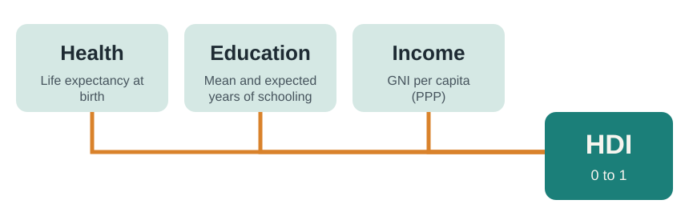
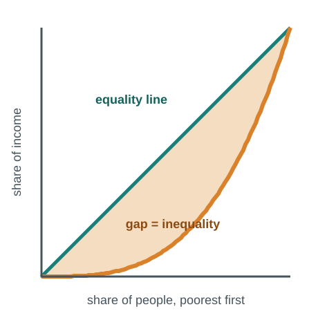
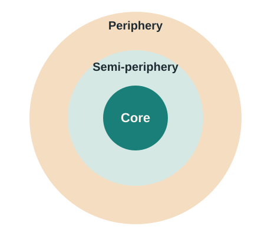
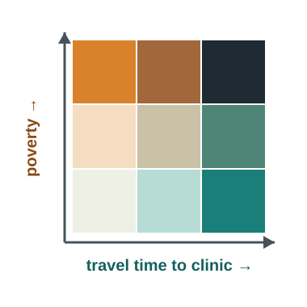
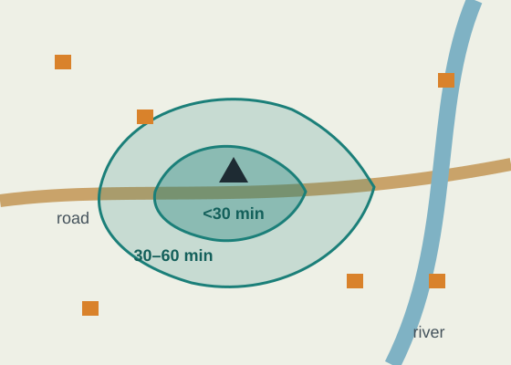

## This week

:::: {.columns}
::: {.column width="32%"}
::: {.card}
**Read**

Chapter 9, Development

Tanser et al. (2006). Modelling and understanding primary health care accessibility and utilization in rural South Africa
:::
:::
::: {.column width="2%"}
:::
::: {.column width="32%"}
::: {.card}
**Map**

Exercise 9.1 The human development report

Exercise 9.3 Density: the rural–urban divide

Exercise 9.4 Distance: proximity to urban areas
:::
:::
::: {.column width="2%"}
:::
::: {.column width="32%"}
::: {.card .tint}
**Be able to**

Explain what the HDI and Gini measure

Make a bivariate map

Model travel time to health care
:::
:::
::::

::: {.notes}
Welcome to Week 6. This week is about development: how we measure health, wealth and opportunity, why they differ so much between and within countries, and how distance shapes access to services. Read Chapter 9 and Tanser and colleagues’ 2006 paper, a classic GIS study that modelled travel time to clinics for every homestead in the ACDIS area. Then complete exercises 9.1, 9.3 and 9.4. The GIS skills beyond the textbook this week are bivariate mapping and travel-time modelling.
:::

## Development means health, wealth and the freedom to choose {background-color="#1B7F79" .dark}

Averages hide who is left out, and distance decides who can reach help.

::: {.notes}
The chapter adopts the United Nations idea of human development: not just income, but health, education and the freedom to choose a life. Two themes run through the chapter that matter for public health. First, national averages hide enormous inequality, between rich and poor, women and men, cities and the countryside. Second, distance from cities and services is one of the strongest predictors of who lags behind. Both are spatial, and both are what this week’s GIS skills are designed to reveal.
:::

## Much has improved

| Indicator | Then | Recently |
|---|---|---|
| Extreme poverty (under $1.90 a day, PPP) | 42% (1981) | under 11% (2013) |
| Access to an improved water source | 76% (1990) | 91% (2015) |
| Life expectancy, women / men | 54 / 50 (1960) | 74 / 70 (2015) |
| Literacy | 76% (1990) | 85% (2010) |

[But a baby in Cambodia was 23 times more likely to die than one in Canada. Progress is real and uneven.]{.muted}

::: {.notes}
The chapter opens with good news. Extreme poverty, living on less than one dollar ninety a day in purchasing power terms, fell from forty-two percent of the world in 1981 to under eleven percent by 2013. Access to an improved water source rose from seventy-six to ninety-one percent between 1990 and 2015. Life expectancy rose from about fifty-four for women and fifty for men in 1960 to about seventy-four and seventy by 2015. Literacy rose too. But the gaps remain large: the chapter notes that a baby was twenty-three times more likely to die in Cambodia than in Canada. Progress is real, and uneven across space.
:::

## The Human Development Index

{fig-alt="The Human Development Index combines three dimensions: health (life expectancy), education (years of schooling) and income (GNI per capita in PPP)" width="65%"}

:::: {.columns}
::: {.column width="50%"}
**PPP (purchasing power parity)** adjusts income for the cost of living, so $1 buys the same basket of goods everywhere.
:::
::: {.column width="50%"}
**Mean years of schooling** looks back at adults aged 25+. **Expected years** looks forward at children entering school.
:::
::::

::: {.notes}
Since 1990 the United Nations has published the Human Development Index, which combines three dimensions into a single score from zero to one. Health is measured by life expectancy at birth. Education is measured two ways: mean years of schooling for adults over twenty-five, which looks backward, and expected years of schooling for children entering school, which looks forward. Income is measured by gross national income per person, adjusted for purchasing power parity, so that a dollar buys the same basket of goods in each country. The chapter’s example: a typical person in France lives like an American on about thirty-eight thousand dollars a year. The HDI is a composite index, and later this week you will see how to build and map composites yourself.
:::

## Averages hide inequality

:::: {.columns}
::: {.column width="40%"}
{fig-alt="Lorenz curve: the farther the income curve sags below the line of equality, the higher the Gini coefficient"}
:::
::: {.column width="60%"}
**Gini coefficient**: 0 = everyone has the same income; 100 = one person has all of it.

- Lowest: Scandinavia and Eastern Europe
- Highest: Latin America and sub-Saharan Africa, including **South Africa**

**Gender Inequality Index**: maternal mortality, adolescent births, women in parliament, secondary education and labour force participation.

[The Lorenz curve is a standard way to visualize the Gini; it is not in the textbook.]{.small .muted}
:::
::::

::: {.notes}
Income per person is an average, and averages hide how income is shared. The Gini coefficient runs from zero, where everyone has the same income, to one hundred, where one person has everything. The Lorenz curve on the left, which goes beyond the textbook, shows the idea: the straight line is perfect equality, and the more the real income curve sags below it, the higher the Gini. The chapter notes that the Scandinavian countries are among the most equal and that South Africa and Brazil are among the most unequal, so their average incomes describe almost nobody. The chapter also introduces the Gender Inequality Index, built from maternal mortality, adolescent births, women’s share of parliamentary seats, secondary education and labour force participation. Maternal mortality in sub-Saharan Africa was thirty-nine times higher than in the most developed countries.
:::

## Development varies within countries too

:::: {.columns}
::: {.column width="50%"}
The United States ranked 10th of 188 countries on the HDI. But at the state level, earnings, education and life expectancy were lower across much of the South and Appalachia.

**Life expectancy in Mississippi** was similar to that of Iraq, Thailand or El Salvador.
:::
::: {.column width="50%"}
::: {.card .tint}
**Scale matters again.** Country, state and county maps of the same indicator tell different stories, and the people most left behind often appear only at the finest scale.
:::
:::
::::

::: {.notes}
Development varies within countries as well as between them. The United States ranked tenth of one hundred eighty-eight countries on the HDI, yet the chapter shows much lower earnings, education and life expectancy across much of the South and Appalachia. Life expectancy in Mississippi was similar to that in Iraq, Thailand or El Salvador. Even within thriving states, places like California’s Central Valley lag behind nearby cities. This is the modifiable areal unit problem again: national figures hide state differences, state figures hide county differences, and the people most left behind often appear only at the finest scale.
:::

## Why do places differ? Competing theories

:::: {.columns}
::: {.column width="38%"}
{fig-alt="World systems theory: a wealthy core, a semi-periphery of lower-wage manufacturing, and a periphery that exports raw materials"}
:::
::: {.column width="62%"}
| Theory | Cause of underdevelopment | Policy |
|---|---|---|
| **Dependency, world systems** | Exploitation, rooted in colonial trade | Import substitution |
| **Modernization (Rostow)** | Not yet through the stages of growth | Aid, technology transfer |
| **Neoliberalism** | Too little market freedom | Privatization, free trade |
:::
::::

[The World Bank's **density, distance, division** framework is explicitly geographic: dense cities, connections to lagging regions, and open borders.]{.muted}

::: {.notes}
The chapter presents competing explanations for why some places develop and others lag. Dependency theory, and the world systems theory that grew from it, argue that underdevelopment results from exploitation: colonial powers set up trade that extracted cheap raw materials and sold back manufactured goods, leaving a wealthy core, a semi-periphery and a poor periphery. The policy response was import substitution industrialisation. Modernisation theory, associated with W. W. Rostow, says all countries pass through stages to high mass consumption, and that aid and technology transfer can speed them along. One correction: the chapter places Britain’s take-off in the late eighteen hundreds; Rostow dated it to the late seventeen hundreds. Neoliberalism holds that markets with minimal government intervention drive growth, and became the Washington Consensus of privatisation and free trade. The chapter also dates NAFTA to 1989; the agreement took effect in 1994. Finally, the World Bank’s density, distance and division framework is explicitly geographic. Note that the chapter itself favours market-based explanations; that is one view in a debate that is still active.
:::

## Density, distance, division

:::: {.columns}
::: {.column width="33%"}
::: {.card}
**Density** · local scale

Dense cities are more productive: shared knowledge, suppliers and infrastructure.
:::
:::
::: {.column width="33%"}
::: {.card}
**Distance** · country scale

Places far from leading cities lag in income, health, education and infrastructure.
:::
:::
::: {.column width="33%"}
::: {.card}
**Division** · international scale

Barriers to trade, migration and ideas hold countries back.
:::
:::
::::

[China's interior prefectures and Brazil's northeast lag far behind their coastal and southern cities. Explore density and distance in **Exercises 9.3 and 9.4**.]{.muted}

::: {.notes}
The World Bank framework works at three scales. Density, at the local scale: cities concentrate people and firms, which raises productivity through shared knowledge, suppliers and infrastructure, so urban areas tend to be wealthier. Distance, at the country scale: places far from leading cities miss out on those benefits and often have poorer roads, electricity and services. In China, interior prefectures lag far behind the coast; in Brazil, per capita disposable income was nearly four and a half times higher in the Federal District than in Maranhão. Division, at the international scale: barriers to trade, migration and the free flow of ideas hold countries back. For public health, distance is the dimension we can measure most directly, and it is the subject of this week’s paper. Exercises 9.3 and 9.4 explore density and distance in the United States.
:::

## Beyond the textbook: mapping two variables at once

:::: {.columns}
::: {.column width="40%"}
{fig-alt="Bivariate legend: a 3 by 3 grid where one colour ramp shows travel time and the other shows poverty; the darkest corner marks areas high on both"}
:::
::: {.column width="60%"}
A **bivariate map** crosses two classed variables, here three classes each, giving nine colours. The dark corner marks areas high on both, such as **poor and far from care**.

**Composite index:** rescale each indicator to 0–1, then average them, like the HDI. Say which indicators, which weights and which direction.

[In ArcGIS Online: Styles → choose two fields → Relationship.]{.small .muted}
:::
::::

::: {.notes}
This slide goes beyond the textbook. Development is multidimensional, and public health often needs to see two conditions together: for example, poverty and distance to care. A bivariate map classifies each variable into, say, three classes and crosses them into nine colours. In this legend, the horizontal ramp shows travel time and the vertical ramp shows poverty, so the darkest corner marks areas that are both poor and far from care, often the top priority for outreach. In ArcGIS Online, the Relationship style does this when you choose two numeric fields. The other way to combine variables is a composite index, like the HDI: rescale each indicator to a common range, often zero to one, and average them. Composites are useful, but they hide choices, so always state which indicators, what weights and which direction counts as worse.
:::

## Public health case: travel time to clinics {background-color="#1E2B33" .dark}

[Tanser et al. 2006 · Hlabisa health sub-district, KwaZulu-Natal]{.eyebrow}

:::: {.columns}
::: {.column width="33%"}
[23,000]{.bignum}

Homesteads interviewed and positioned with GPS
:::
::: {.column width="33%"}
[81 min]{.bignum}

Median travel time to the nearest clinic
:::
::: {.column width="33%"}
[65%]{.bignum}

Of homesteads travelled an hour or more to the nearest clinic
:::
::::

[Source: Tanser F, Gijsbertsen B, Herbst K. Soc Sci Med. 2006;63(3):691-705. [doi:10.1016/j.socscimed.2006.01.015](https://doi.org/10.1016/j.socscimed.2006.01.015)]{.small}

::: {.notes}
This week’s paper is a landmark in health geography. Tanser and colleagues interviewed and positioned about twenty-three thousand homesteads in the Hlabisa health sub-district, asking which clinic each used. Straight-line distance would badly misrepresent access in a rural area with few roads, so they built a cost model in a GIS. The model is the next slide. The headline results: the median travel time to the nearest clinic was eighty-one minutes, sixty-five percent of homesteads travelled an hour or more, and the median travel time to the district hospital was one hundred seventy minutes.
:::

## Modelling access with a cost surface {background-color="#1E2B33" .dark}

:::: {.columns}
::: {.column width="50%"}
{fig-alt="Travel-time zones around a clinic stretch along the road and stop at the river; outlying homesteads lie beyond an hour"}

[Schematic of travel-time zones]{.small}
:::
::: {.column width="50%"}
::: {.card}
The model combined **walking time**, the likelihood of using **public transport**, the **road network**, and **natural barriers** such as rivers, calibrated with reported travel times. It predicted the clinic people used with **91% accuracy**.
:::

::: {.card}
Homesteads within **30 minutes** had **10 times** the odds of using a clinic compared with those 90–120 minutes away.
:::
:::
::::

::: {.notes}
Here is how the model worked. For any location, it estimated travel time to each clinic, accounting for walking, the chance that people would take public transport, which depends on how far they would otherwise walk, the quality and layout of the road network, and natural barriers such as rivers. The authors calibrated the model with travel times people reported. It predicted which clinic a homestead actually used with ninety-one percent accuracy, which is strong validation. The schematic shows the idea: travel-time zones stretch along the road and stop at the river, instead of forming circles. Clinic use fell steeply with travel time. After adjustment, homesteads within thirty minutes of a clinic had ten times the odds of using one, compared with homesteads ninety to one hundred twenty minutes away. This is cost distance from Week 1, applied to a real health system, and it is the method behind many later studies of access to HIV care.
:::

## Critical lens: whose development?

:::: {.columns}
::: {.column width="50%"}
::: {.card}
**Colonial roots.** Dependency theory, in the textbook, traces underdevelopment to colonial trade that extracted raw materials. Many economies still depend on them: 61% of Sierra Leone's GDP came from agricultural exports.
:::
:::
::: {.column width="50%"}
::: {.card}
**Unequal investment.** Under apartheid, the rural homelands received far less investment in roads, water and clinics than white areas. Long travel times to care, as in this week's paper, partly reflect that history.
:::
:::
::::

[Who decides what counts as "developed"? Indices are built by international institutions, and conditions such as those of the Washington Consensus were set by lenders, not borrowers.]{.muted}

::: {.notes}
A critical lens on development. The word itself can imply that some places are behind on a single path that wealthy countries have already walked, the assumption built into Rostow’s stages. The textbook’s account of dependency theory gives another view: underdevelopment was produced, in part, by colonial trade that extracted raw materials and sold back manufactured goods. That pattern persists; the chapter reports that sixty-one percent of Sierra Leone’s GDP came from agricultural exports. In South Africa, distance to care is not only a matter of rural geography. Under apartheid, the rural homelands received far less investment in roads, water and health facilities than areas reserved for white South Africans, and the long travel times in this week’s paper partly reflect that history. Finally, ask who defines development. Indices are designed by international institutions, and in the Washington Consensus era, lenders set the policy conditions borrowing countries had to accept. None of this makes the HDI useless, but it is a reminder that every measure carries a point of view.
:::

## Questions to ask any development map {background-color="#1B7F79" .dark}

:::: {.columns}
::: {.column width="50%"}
1. Average or distribution?
2. Which indicators, weighted how?
3. Income in PPP or exchange rates?
:::
::: {.column width="50%"}
4. Straight-line distance or modelled travel time?
5. Which scale hides the people left behind?
6. Whose definition of development?
:::
::::

::: {.notes}
To wrap up, six questions for any development map. Is it showing an average or a distribution? If it is a composite, which indicators and what weights? Is income adjusted for purchasing power? Is access measured in straight-line distance or modelled travel time? At which scale might the people most left behind disappear? And whose definition of development does the map use? These are on your handout.
:::

## Your Week 6 tasks

| Task | Where |
|---|---|
| Read Chapter 9 | Textbook |
| Read Tanser et al. (2006) | [Readings page](../../readings.qmd) |
| Exercises 9.1, 9.3 and 9.4 | ArcGIS Online |
| Reading check | Canvas |

**Optional practice:** Exercises 9.2 The invisible hand, and 9.5 Globalization or protectionism. **Exercise links:** [esri.com/Human-Geography](https://www.esri.com/Human-Geography). Due dates are in Canvas.

::: {.notes}
Before Week 7, read Chapter 9 and Tanser and colleagues, complete exercises 9.1, 9.3 and 9.4 in ArcGIS Online, and complete the reading check in Canvas. Exercises 9.2 and 9.5 are optional extra practice. The Week 6 handout has the development measures, the bivariate mapping steps and the travel-time workflow.
:::
