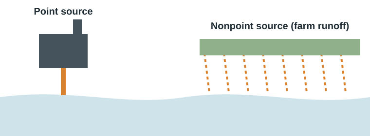
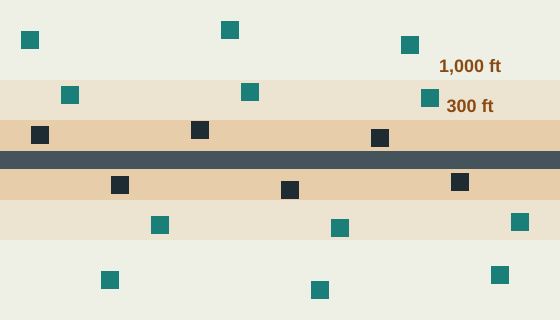
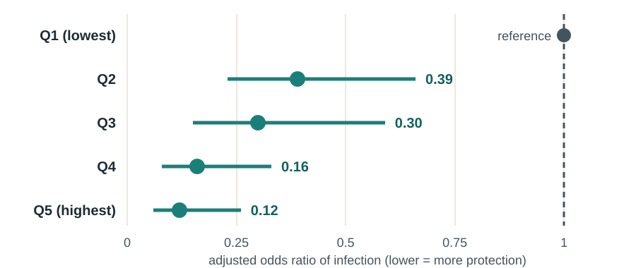
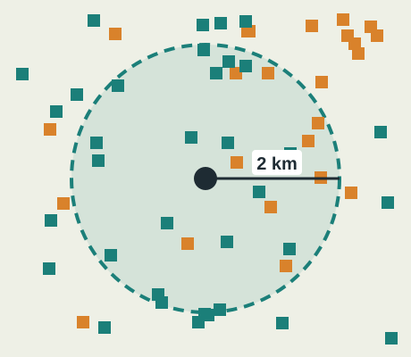

## This week

:::: {.columns}
::: {.column width="32%"}
::: {.card}
**Read**

Chapter 12, Humans and the environment

Tanser et al. (2018). Impact of the scale-up of piped water on urogenital schistosomiasis infection in rural South Africa
:::
:::
::: {.column width="2%"}
:::
::: {.column width="32%"}
::: {.card}
**Map**

Exercise 12.2 Air pollution exposure at a local scale

Exercise 12.3 Sanitation and human health

Exercise 12.5 Global carbon emissions
:::
:::
::: {.column width="2%"}
:::
::: {.column width="32%"}
::: {.card .tint}
**Be able to**

Assess exposure with buffers and overlays

Explain point and nonpoint pollution

Build a final map that uses every skill from the course
:::
:::
::::

::: {.notes}
Welcome to the final week. Chapter 12 covers how humans pollute air, water and land and change the climate, and what that means for health. This week’s paper, by Tanser and colleagues in 2018, uses ACDIS data to show how piped water protected children from a waterborne parasitic disease. Complete exercises 12.2, 12.3 and 12.5. This week also brings the course together: the final slides walk through a capstone map that uses the skills from every week.
:::

## Exposure is spatial {background-color="#1B7F79" .dark}

Where you live decides the air you breathe, the water you drink and the waste you live beside.

::: {.notes}
The organising idea for this week is exposure. Environmental health hazards are not spread evenly. Air pollution is worst near highways, ports and factories and in valleys that trap smog. Water contamination depends on what lies upstream and whether there is a safe supply. Waste ends up near some communities and not others. Because exposure depends on location, GIS is one of the main tools of environmental epidemiology.
:::

## Pollution: added faster than it can disperse

:::: {.columns}
::: {.column width="50%"}
**Pollution** occurs when a substance is added to the environment faster than it can be dispersed, decomposed or diluted.

The **Anthropocene** is the proposed name for an epoch in which human actions drive change in the Earth system. The chapter argues human impact began tens of thousands of years ago.
:::
::: {.column width="50%"}
{fig-alt="Point source pollution comes from one pipe at a factory; nonpoint source pollution runs off a wide area such as farmland"}

**Point source**: one location, such as a discharge pipe. **Nonpoint source**: diffuse runoff from farms and streets, harder to regulate.
:::
::::

::: {.notes}
The chapter defines pollution as a substance added to the environment faster than it can be dispersed, decomposed or diluted. Smoke from one fire disperses; smoke from thousands of chimneys and vehicles over a city becomes pollution. It introduces the Anthropocene, a proposed epoch in which humans drive environmental change, and argues that human impact began long before industry, with fire, hunting and farming. For water in particular, the chapter distinguishes point sources, single locations like a factory discharge pipe, from nonpoint sources, diffuse runoff from farms and city streets. Early regulation focused on point sources, which are easier to find and control; nonpoint pollution, such as fertiliser runoff, remains a major problem.
:::

## Air pollution

:::: {.columns}
::: {.column width="50%"}
- Over **80%** of urban residents breathe air above WHO limits; **98%** in low- and middle-income countries, **56%** in high-income
- **PM2.5** particles reach deep into the lungs: stroke, heart disease, lung cancer, asthma
- Mortality maps use **age-standardized** rates, the fix from Week 2
:::
::: {.column width="50%"}
::: {.card .tint}
**Place matters within cities.** Health risks are substantial within **300 feet** of a freeway and can extend past **1,000 feet**. Valleys and still air trap smog; homes downwind of sources are exposed most.
:::

[WHO's PM2.5 guideline was 10 μg/m³ when the textbook was written; WHO lowered it to 5 μg/m³ in 2021.]{.small .muted}
:::
::::

::: {.notes}
The chapter reports that more than eighty percent of people in urban areas breathe air above World Health Organization limits, ninety-eight percent in low- and middle-income countries compared with fifty-six percent in high-income ones. Fine particulate matter, PM2.5, penetrates deep into the lungs and raises the risk of stroke, heart disease, lung cancer and asthma. Notice that the chapter’s air pollution mortality map uses age-standardised rates, exactly the fix we discussed in Week 2, so that countries with older populations do not look misleadingly worse. Within countries, exposure depends on place: health risks are substantial within about three hundred feet of a freeway and can extend past one thousand feet, and topography and wind trap or carry pollution. One update beyond the textbook: the WHO guideline for annual PM2.5 was ten micrograms per cubic metre when the book was written, and WHO lowered it to five in 2021. Exercise 12.2 has you assess exposure at a local scale.
:::

## Water and sanitation

:::: {.columns}
::: {.column width="50%"}
- Over **80%** of wastewater worldwide is discharged untreated: about **70%** is treated in high-income countries, **8%** in low-income
- **2.4 billion** people lacked improved sanitation; about **1 billion** practised open defecation
- Faecal contamination spreads diarrhoea, cholera, trachoma and **schistosomiasis**
:::
::: {.column width="50%"}
::: {.card}
**Solutions do not have to be sewers.** Pit latrines, composting toilets and collection services can work, if waste is contained, transported and treated. Infrastructure alone is not enough without behaviour change.
:::
:::
::::

Explore sanitation and health in **Exercise 12.3**.

::: {.notes}
The greatest waterborne threat to health, the chapter argues, is untreated human waste. More than eighty percent of the world’s wastewater is discharged without treatment: about seventy percent is treated in high-income countries but only eight percent in low-income ones. About two point four billion people lacked improved sanitation and about one billion practised open defecation. Faecal contamination spreads diarrhoea, cholera, trachoma and schistosomiasis, the disease in this week’s paper. Solutions need not be expensive sewer systems: pit latrines, composting toilets and pumped collection can work, as long as waste is contained and treated. The chapter’s example from rural India also shows that building toilets is not enough without education and behaviour change. Exercise 12.3 maps sanitation and mortality.
:::

## Land pollution and solid waste

| Disposal | Controls | Risk |
|---|---|---|
| **Open dump** | Little or none | Contaminated water and air, disease vectors, waste pickers exposed |
| **Controlled landfill** | Liner, compaction, daily soil cover | Lower |
| **Sanitary landfill** | Contains and treats nearly all leachate | Lowest |

High-income countries collect about **98%** of municipal solid waste; low-income countries about **41%**. In the US, the 1980 **Superfund** law followed the Love Canal disaster.

::: {.notes}
Solid waste production rises with urbanisation and wealth: urban residents produce about twice as much as rural ones. What matters for health is collection and disposal. High-income countries collect about ninety-eight percent of municipal waste; low-income countries about forty-one percent, and uncollected waste spreads pathogens and clogs drains. Disposal ranges from open dumps with little control, where informal waste pickers face the greatest risk, to controlled landfills with liners and daily cover, to sanitary landfills that contain nearly all leachate. In the United States, homes and a school built on a chemical dump at Love Canal led to the 1980 Superfund law, which makes polluters pay for cleanup. Exercise 12.4, optional this week, maps Superfund sites.
:::

## Climate change and health

:::: {.columns}
::: {.column width="50%"}
- **CO₂** above **400 ppm** by 2017, higher than in 400,000 years of ice-core records
- **Sea level** up about **80 mm** since 1993
- **Weather** is short-term; **climate** is the long-term pattern
:::
::: {.column width="50%"}
::: {.card}
**Health pathways:** heat waves, more ozone and wildfire smoke, flooding that spreads pathogens, and volatile food supplies.

**Most at risk:** drylands with variable rain, low-lying coasts with cyclones, and low atolls.
:::
:::
::::

**Mitigation** reduces greenhouse gases. **Adaptation** reduces vulnerability: cooling centres, flood-aware planning, resilient water systems.

::: {.notes}
The chapter summarises the evidence for climate change. Carbon dioxide passed four hundred parts per million by 2017, higher than at any point in four hundred thousand years of ice-core records, and global temperature and sea level are rising: about eighty millimetres since 1993 from satellite measurements. It distinguishes weather, short-term conditions, from climate, the long-term pattern: no single storm proves climate change, but warming raises the probability of extreme events. The health pathways include heat waves, more ozone and wildfire smoke, flooding that carries pathogens, and more volatile food production and prices. The chapter names three kinds of places most at risk: drylands with variable rainfall, low-lying coasts in cyclone zones, and low atolls. Responses are mitigation, reducing greenhouse gases, and adaptation, reducing vulnerability, including public health measures such as cooling centres. Two small corrections: the chapter calls Hurricane Katrina category 5; it was category 3 at landfall. And it places Syria in North Africa; Syria is in the Middle East. Exercise 12.5 maps global carbon emissions.
:::

## Beyond the textbook: assessing exposure in a GIS

:::: {.columns}
::: {.column width="50%"}
{fig-alt="Proximity exposure: buffers of 300 feet and 1,000 feet around a freeway; homes inside the inner buffer face the highest pollution exposure"}
:::
::: {.column width="50%"}
| Method | Question |
|---|---|
| **Proximity buffer** | Who lives within 300 ft of a freeway? |
| **Overlay** | Which homes fall in a flood zone? |
| **Interpolated surface** | What is PM2.5 between monitors? |
| **Community coverage** | What share of neighbours have safe water? |

[In ArcGIS Online: Create Buffers, Overlay Layers, Interpolate Points, Summarize Within. All use credits.]{.small .muted}
:::
::::

::: {.notes}
This slide goes beyond the textbook and pulls together tools from earlier weeks. Proximity buffers, from Week 5, answer questions like who lives within three hundred feet of a freeway. Overlays find which homes fall inside a hazard area such as a flood zone. Interpolation estimates a continuous surface, a raster from Week 1, from point measurements such as air quality monitors, so you can assign an estimated exposure to every home. And community coverage, the method in this week’s paper, measures the conditions in the area around each person rather than only their own household. In ArcGIS Online, Create Buffers, Overlay Layers, Interpolate Points and Summarize Within do these jobs, and all use credits.
:::

## Public health case: piped water and schistosomiasis {background-color="#1E2B33" .dark}

[Tanser et al. 2018 · ACDIS, 2001–2007]{.eyebrow}

:::: {.columns}
::: {.column width="33%"}
[42→80%]{.bignum}

Households with piped water, 2001 to 2007
:::
::: {.column width="33%"}
[2,105]{.bignum}

Primary school children tested; 16.8% infected
:::
::: {.column width="33%"}
[0–85%]{.bignum}

Local prevalence, with 4 hot spots around open water collection sites
:::
::::

[Source: Tanser F, Azongo DK, Vandormael A, Bärnighausen T, Appleton C. eLife. 2018;7:e33065. [doi:10.7554/eLife.33065](https://doi.org/10.7554/eLife.33065)]{.small}

::: {.notes}
Urogenital schistosomiasis is a parasitic disease spread by snails in fresh water contaminated by human waste, and children are infected when they swim, bathe or collect water. Between 2001 and 2007, piped water coverage in the ACDIS area almost doubled, from forty-two to eighty percent of households, but it expanded unevenly across communities, creating a natural experiment. Tanser and colleagues tested two thousand one hundred five primary school children and found sixteen point eight percent infected, twice as many boys as girls. A kernel surface showed local prevalence from zero to eighty-five percent, and the scan statistic from Week 4 found four high-risk clusters around open water collection sites, two of them along the Nsane River.
:::

## Community coverage protected far more than a household tap {background-color="#1E2B33" .dark}

:::: {.columns}
::: {.column width="58%"}
{fig-alt="Adjusted odds of urogenital schistosomiasis by community piped water coverage quintile: Q2 0.39, Q3 0.30, Q4 0.16, Q5 0.12, compared with the lowest quintile"}

[Adjusted odds ratios (95% CI) by quintile of piped water coverage in each child's surrounding community]{.small}
:::
::: {.column width="42%"}
{fig-alt="Community exposure: around each child's home, a 2 km kernel measures the share of all nearby households with piped water (teal) versus without (orange)" width="62%"}

**Highest vs lowest coverage:** aOR **0.12**, about 8 times lower odds. **Household tap alone:** aOR **0.54**.

Each 1% increase in community coverage: about **2.5%** lower odds.
:::
::::

::: {.notes}
The key design choice was the exposure measure. Instead of asking only whether a child’s own household had piped water, the authors used a two-kilometre kernel around each child’s home to calculate the share of all surrounding households with piped water, averaged over the years before testing. That captures indirect protection: when fewer neighbours use open water, fewer people contaminate it, a little like herd immunity. The results show a clear dose-response. Compared with the lowest-coverage communities, the adjusted odds of infection were point three nine, point three zero, point one six and point one two in successive quintiles. Children in the highest-coverage communities were about eight times less likely to be infected. Each one percent increase in community coverage was associated with about a two point five percent decrease in the odds of infection. Household access alone had a much smaller effect, an odds ratio of point five four. The lesson for GIS: how you define exposure spatially can change your answer by a factor of four.
:::

## Critical lens: who lives next to the hazard?

:::: {.columns}
::: {.column width="50%"}
::: {.card}
**Environmental racism**

Protests against a toxic waste landfill in a majority-Black county in Warren County, North Carolina, in 1982 helped launch the environmental justice movement. Studies since have found hazardous facilities sited disproportionately near communities of colour.
:::
:::
::: {.column width="50%"}
::: {.card}
**Global inequity**

Wealthy countries have exported hazardous waste to poorer ones, prompting the Basel Convention (1989) and the African Bamako Convention (1991). The countries least responsible for climate change are often the most exposed to it.
:::
:::
::::

[In our study area, the expansion of piped water after apartheid reached some communities years before others, and that sequence is visible in children's infection risk.]{.muted}

::: {.notes}
A critical lens on environmental health. The environmental justice movement in the United States is often traced to 1982, when residents of majority-Black Warren County, North Carolina, protested a landfill for soil contaminated with toxic PCBs. Studies since then have repeatedly found hazardous facilities sited disproportionately near low-income communities and communities of colour, the pattern Week 4 introduced. The same inequity operates globally. Wealthy countries have shipped hazardous waste to poorer ones, which led to the Basel Convention in 1989 and the African Union’s predecessor adopting the stricter Bamako Convention in 1991. And the countries that have contributed least to greenhouse gas emissions are often the most exposed to climate change, as the chapter notes for drylands, coasts and atolls. In our own case study, piped water expanded across the ACDIS area during the 2000s, reaching some communities years before others, and that sequence is visible in which children were infected.
:::

## Capstone: one map, every skill

| Week | Skill to show in your final map |
|---|---|
| 1 | Quality data with metadata, a suitable projection, honest class breaks |
| 2 | Rates, not counts, with the right denominator |
| 3 | Mobility or flows where they matter |
| 4 | A joined table, a tested cluster or a location quotient |
| 5 | Access: a buffer or travel-time area |
| 6 | Two variables together, or a composite index |
| 7 | An exposure measure, and a critical-lens note on whose data and whose history |

: {tbl-colwidths="[12,88]"}

[Your instructor will post the capstone instructions in Canvas.]{.muted}

::: {.notes}
The final project brings the course together in a single public health map. Use quality data and document its metadata, choose a sensible projection and honest class breaks from Week 1, map rates with the right denominator from Week 2, consider mobility from Week 3, use a table join, tested cluster or location quotient from Week 4, measure access from Week 5, combine two variables from Week 6, and define an exposure from this week. Finish with a short critical-lens note: whose data is this, who is missing, and what history shaped the pattern. Your instructor will post the full instructions in Canvas.
:::

## Questions to ask any exposure map {background-color="#1B7F79" .dark}

:::: {.columns}
::: {.column width="50%"}
1. Measured, modelled or interpolated?
2. Household or community exposure?
3. Which distance, and why that distance?
:::
::: {.column width="50%"}
4. Point or nonpoint source?
5. Crude or age-standardized outcomes?
6. Who lives next to the hazard, and why?
:::
::::

::: {.notes}
To finish, six questions for any exposure map. Is exposure measured, modelled or interpolated? Is it defined at the household or the community level? Which distance was used, and why that one? Is the source a point or diffuse? Are outcomes crude or age-standardised? And who lives next to the hazard, and why? These are on your handout. Thank you for working through the course. You now have the skills to make and question the maps that public health decisions depend on.
:::

## Your Week 7 tasks

| Task | Where |
|---|---|
| Read Chapter 12 | Textbook |
| Read Tanser et al. (2018) | [Readings page](../../readings.qmd) |
| Exercises 12.2, 12.3 and 12.5 | ArcGIS Online |
| Reading check and capstone | Canvas |

**Optional practice:** Exercises 12.1 US air pollution and 12.4 Superfund sites. **Exercise links:** [esri.com/Human-Geography](https://www.esri.com/Human-Geography). Due dates are in Canvas.

::: {.notes}
For the final week, read Chapter 12 and Tanser and colleagues, complete exercises 12.2, 12.3 and 12.5 in ArcGIS Online, and complete the reading check and capstone in Canvas. Exercises 12.1 and 12.4 are optional extra practice. Keep all seven handouts: together they are a reference for every skill in the course.
:::
